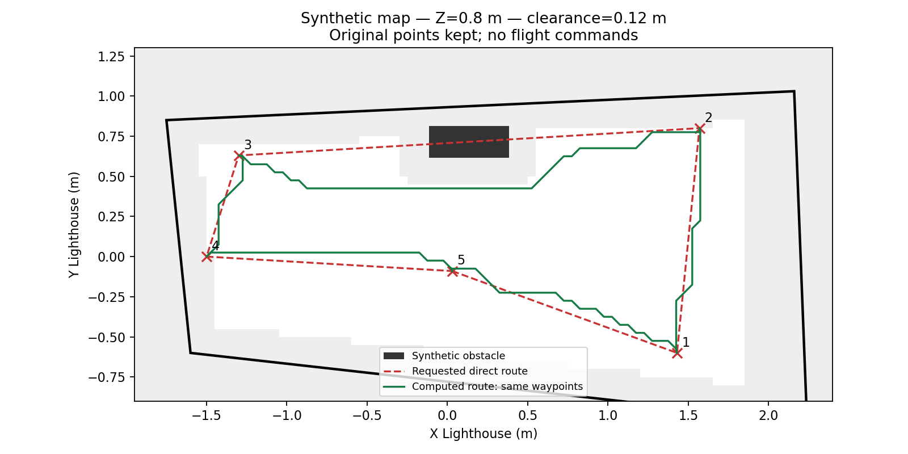
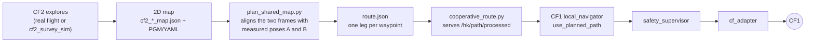
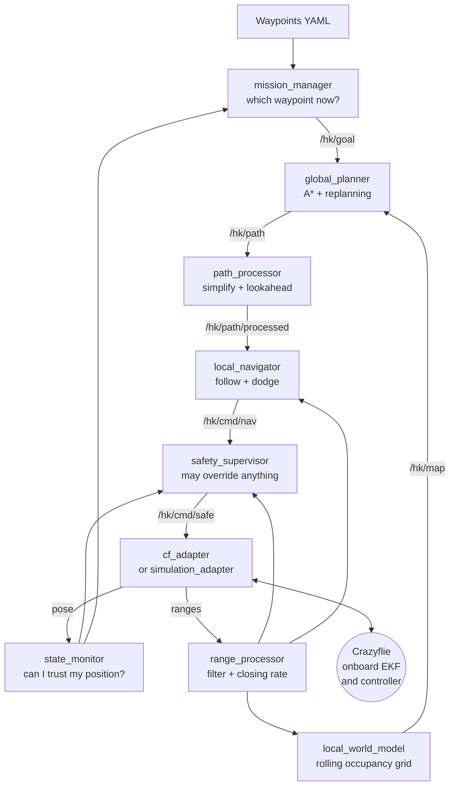
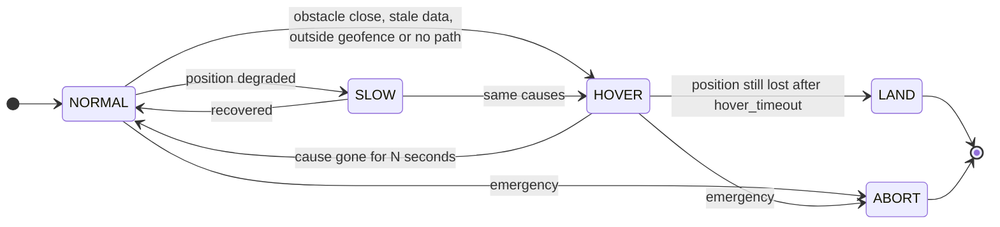

# Mobile Robotics Hackathon — Crazyflie Autonomous Navigation

**Two Crazyflie drones that cooperate: one maps an unknown room, the other flies a route planned on that map.** Built for the *Autonomous Navigation* challenge of the Mobile Robotics Hackathon 2026 (TU Dresden, 10–11 October 2026) on ROS 2 Humble and Crazyswarm2.

Everything in this repository runs **without a drone and without a radio**: our own simulator with a Multi-ranger model, an emulator of the Crazyswarm2 API, fault injection and an automatic pass/fail test matrix. The same stack runs on hardware by swapping one package.

| | |
|---|---|
| **Problem** | A drone must reach a list of waypoints in a room it does not know, without hitting anything, and do something sensible when a sensor or the position fails. |
| **Our answer** | Split the job in two. **CF2** carries the distance sensors and builds a 2D map. **CF1** carries the absolute positioning and flies a route planned on that map. |
| **Status** | 16/16 scenarios of the test matrix pass, plus the cooperative scenario. Simulation only; no validated flight of this stack on hardware. |



*The five crosses are the requested waypoints. The red dashed line joins them directly and crosses the obstacle. The green line is the route A\* computed on the CF2 map: same waypoints, same order, but it goes around the obstacle and keeps clear of the walls.*

---

## Table of contents

- [The idea: two drones, one map](#the-idea-two-drones-one-map)
- [Quick start](#quick-start)
- [How the stack works](#how-the-stack-works)
- [Safety: three independent layers](#safety-three-independent-layers)
- [Verification](#verification)
- [Known limitations](#known-limitations)
- [Repository structure](#repository-structure)
- [Documentation index](#documentation-index)
- [Hardware and software](#hardware-and-software)

---

## The idea: two drones, one map

The two Crazyflies carry different decks, so neither can do the whole job alone:

| | **CF1 — navigation** | **CF2 — mapping** |
|---|---|---|
| **Decks** | Lighthouse + Flow | Flow + Multi-ranger (ToF) |
| **Knows where it is** | Yes, absolutely (Lighthouse `map` frame) | Only relative to its own takeoff point (Flow) |
| **Sees obstacles** | No | Yes, five distance rays |
| **Role** | Flies the waypoint mission with planning, route following and a safety supervisor | Explores the room and builds a 2D occupancy map |
| **Main code** | `mission_manager`, `local_navigator`, `safety_supervisor`, `cf_adapter` | `scripts/cf2_*.py`, `global_planner`, `local_navigator` |

CF2 sees obstacles but does not know where it is in the room. CF1 knows exactly where it is but is blind. Putting the two together gives a drone that can plan a safe route:



Two rules keep this honest:

1. **Unknown space is never treated as free.** The planner blocks any cell CF2 did not observe, so CF1 never flies through a gap that simply was not measured.
2. **The two frames must be aligned before trusting the map.** CF2 works in its own takeoff frame and CF1 in the Lighthouse frame. `plan_shared_map.py` needs two measured reference poses (A and B) to compute the transform, and it refuses to run without them unless you pass `--allow-simulation`.

## Quick start

On Ubuntu 22.04 (or WSL 2) with ROS 2 Humble and Crazyswarm2 installed — the step-by-step installation guide is [SETUP_STATUS_WSL_ROS2.md](SETUP_STATUS_WSL_ROS2.md):

```bash
bash scripts/build.sh && source ros2_ws/install/setup.bash
```

**See one drone navigate around an obstacle** (own simulator, RViz window):

```bash
ros2 launch hackathon_bringup simulation.launch.py scenario:=T05_popup_obstacle rviz:=true
```

**Run the whole test matrix** and get a pass/fail table in `/tmp/hk_runs/results.csv`:

```bash
bash scripts/run_all_scenarios.sh
```

**See the two drones cooperate**, end to end, with no radio:

```bash
# 1. CF2 explores and writes a 2D map
python3 scripts/cf2_survey_sim.py --scenario obstacles --headless
python3 scripts/cf2_export_map.py data/runs/cf2_sim_<session>_map.json

# 2. CF1 plans a route on that map
python3 scripts/plan_shared_map.py --map data/runs/cf2_sim_<session>_map.json \
  --mission <mission.yaml> --reference-a <A.json> --reference-b <B.json> \
  --start <x> <y> <z> --robot-radius 0.10 --output route.json --allow-simulation

# 3. CF1 flies it through the full stack (emulated Crazyswarm2 API), with RViz
ros2 launch hackathon_bringup simulation_cf.launch.py scenario:=C01_cooperative_route rviz:=true
```

The RViz window shows the CF2 map, the planned route in blue, the current leg in orange and the flown trajectory in red.

**Check that it actually worked** — this runs the full chain (pose → health → mission → navigation → safety → adapter → landing) and prints PASS or FAIL:

```bash
python3 scripts/verify_mvp_integration.py --scenario C01_cooperative_route
```

## How the stack works

Every box is one ROS 2 node. Data flows left to right; the only node allowed to command the drone is the safety supervisor.



**The laptop never controls the motors.** It sends high-level setpoints (go to this point, or move at this velocity); the Crazyflie firmware handles attitude and motors onboard. That division is what makes the same code run in simulation and on hardware.

What each part does, in one line:

| Node | Job |
|---|---|
| `mission_manager` | Reads the waypoint list and decides which one is the current goal. Handles takeoff, landing, pause and abort. |
| `local_world_model` | Builds a rolling 2D grid from the four horizontal distance rays: free along each ray, occupied at the endpoint, unknown elsewhere. Obstacles expire after a few seconds, so a box that is removed disappears from the map. |
| `global_planner` | Runs A\* on that grid, adds a cost for flying near obstacles, replans when the path becomes blocked, and reports `NO_PATH` instead of advancing blindly. |
| `path_processor` | Removes useless points from the route and produces the lookahead point the follower aims at. |
| `local_navigator` | Follows the lookahead with speed and acceleration limits, and pushes sideways when a ranger sees something close. |
| `state_monitor` | Answers one question: can I trust the position I am receiving? Outputs `GOOD`, `DEGRADED` or `LOST`. |
| `range_processor` | Validates each distance reading, filters spikes and computes how fast each obstacle is approaching. |
| `safety_supervisor` | The last word. Hovers, slows, lands or aborts, whatever the rest of the stack asked for. |
| `cf_adapter` | The only package that talks to Crazyswarm2. Swapping it for `simulation_adapter` is the whole difference between hardware and simulation. |
| `telemetry` / `hackathon_tests` | Measure the run and decide pass or fail against the scenario's expected result. |

### Two design decisions worth knowing

**The drone does not turn to face where it is going** (`face_target: false`). Turning the body sweeps the five distance rays across the room, and the supervisor reads that sweep as obstacles rushing towards the drone, which makes it stop for no reason. Holding the heading removes the false alarm. Set `face_target: true` if your platform needs to point where it flies.

**A ranger that gets no echo back does not prove the space is clear.** A dark or glass surface returns nothing, exactly like empty air. Those rays leave the cells unknown instead of marking them free, so the map never erases a wall it had already seen.

## Safety: three independent layers

Three state machines run at the same time and do not replace each other. The safety one has priority over the other two.



| Layer | States | Package |
|---|---|---|
| **Mission** | Check → Take off → Navigate ⇄ Avoid → Next waypoint → Land | `mission_manager` |
| **Localization health** | `GOOD`, `DEGRADED`, `LOST` | `state_monitor` |
| **Safety** | `NORMAL`, `SLOW`, `HOVER`, `LAND`, `ABORT` | `safety_supervisor` |

The supervisor does not compare the raw distance against a threshold. It subtracts the **stopping distance** first: a drone approaching a wall at 1 m/s needs time to react and then to brake, so the margin it needs depends on how fast it is closing in. Flying parallel to a wall does not count as approaching it.

## Verification

Everything below is **simulation**. It shows the software behaves correctly against a modelled world; it is not evidence of a real flight.

Last full run on 1 November 2026, ROS 2 Humble on WSL 2, from a clean checkout:

| Check | Command | Result |
|---|---|---|
| Build | `scripts/build.sh` | 14 packages, no errors |
| Unit tests | `colcon test` | 231 tests, 0 failures, 1 skipped |
| Script tests | `pytest scripts/test_*.py` | 77 tests, 0 failures |
| Test matrix T01–T16 | `scripts/run_all_scenarios.sh` | **16 / 16 PASS**, 0 collisions |
| End-to-end, single drone | `verify_mvp_integration.py` T01, T02, T04 | PASS |
| End-to-end, cooperative route | `verify_mvp_integration.py` C01, 3 consecutive runs | PASS 3 / 3 |
| CF2 exploration | `cf2_survey_sim.py`, empty and with obstacles | 28 / 28 targets, 83.8 % and 82.2 % of the area observed |
| Full loop: CF2 map → plan → CF1 flight | both maps | PASS on both, 5 legs each |

The simulator adds sensor and pose noise, so the measured margins move a little between runs. In the run above `T03_static_wall` cleared the wall by 0.32 m, against the 0.20 m its scenario demands; across runs it has stayed between 0.23 m and 0.32 m.

### The test matrix

Sixteen scenarios, each one a world plus a mission plus an injected fault plus an expected result. The runner compares the measured metrics against that expectation and writes a row to `results.csv`.

| | Scenario | What it injects | What must happen |
|---|---|---|---|
| T01 | single waypoint | — | reaches the goal |
| T02 | multiple waypoints | — | visits them in order |
| T03 | static wall | — | maps it and goes around it |
| T04 | corridor | — | keeps a margin on both sides |
| T05 | obstacle appears | box pops up mid-route | slows or hovers, no collision |
| T06 | obstacle disappears | box removed | the map forgets it and the route reopens |
| T07 | obstacle approaches | box moves towards the drone | brakes on time-to-collision |
| T08 | range spike | one bad reading | the filter ignores it |
| T09 | range dropout | rangers go silent | degrades safely |
| T10 | delayed pose | position arrives 0.5 s late | detects it and stops normal navigation |
| T11 | frozen pose | position stops updating | health goes `LOST` |
| T12 | position lost | position stream dies | hovers, then lands |
| T13 | unreachable goal | goal walled in | reports `NO_PATH`, does not advance |
| T14 | geofence | mission outside the allowed box | the setpoint is clamped |
| T15 | ceiling | low ceiling | stays inside the height envelope |
| T16 | commands stop | the command stream pauses | watchdog hovers |
| C01 | cooperative route | — | CF1 flies the route CF2's map produced |

Details and the manual procedures for T17 (restart a node) and T18 (replay a rosbag) are in [docs/simulations.md](docs/simulations.md).

## Known limitations

Read this before judging the results.

- **Simulation only.** The CF2 simulator is ideal and the CF1 emulator is kinematic. Neither models Flow drift, radio latency or real aerodynamics. No flight of this stack on hardware has been validated.
- **The frame alignment needs real measurements.** Linking the CF2 map to the Lighthouse frame requires poses A and B measured on the day of the flight. The example route uses a synthetic map and `--allow-simulation`.
- **The cooperative route zig-zags by about 10 cm.** The grid is 5 cm, so the route follows a staircase. It stays inside the clearance, but it is not a smooth path.
- **The WSL emulator freezes for ~1.2 s roughly every 30 s.** The stack goes to `HOVER` and recovers by itself. On a native machine this does not happen.
- **Narrow corridors stop the drone.** The supervisor hovers when any horizontal ranger reads under 0.3 m, so a corridor under about 1 m wide is not flyable with the default configuration. T04 uses a 1.0 m corridor for this reason.
- **Not implemented:** per-node latency metrics, the single-command `event.launch.py`, validation on native Ubuntu, and T17/T18 as automated tests.

> **Branch history:** `tp*`, `integration-mvp-crazyswarm` (CF1) and `integration/cf2-navigation-mapping` (CF2) are kept as a backup.

## Repository structure

```text
.
├── README.md
├── SETUP_STATUS_WSL_ROS2.md    # install WSL 2 + ROS 2 + Crazyswarm2 from scratch
├── docs/                       # see the documentation index below
├── ros2_ws/src/
│   ├── hackathon_interfaces/   # our own messages and services
│   ├── hackathon_bringup/
│   │   ├── launch/             # simulation.launch.py, simulation_cf.launch.py, real.launch.py
│   │   ├── rviz/               # hackathon.rviz, cf1_route.rviz, cf2_live.rviz
│   │   └── config/             # parameters, worlds, missions, scenarios T01-T16 + C01
│   ├── simulation_adapter/     # our simulator: world, raycasts, dynamics, faults, CS2 emulator
│   ├── cf_adapter/             # the only package that talks to Crazyswarm2
│   ├── state_monitor/          # single state topic + localization health
│   ├── range_processor/        # Multi-ranger validation, filtering, rays in the map frame
│   ├── local_world_model/      # rolling occupancy grid
│   ├── mission_manager/        # waypoints + mission state machine
│   ├── global_planner/         # A* + replanning
│   ├── path_processor/         # route simplification + lookahead
│   ├── local_navigator/        # path follower + reactive avoidance + route mode
│   ├── safety_supervisor/      # NORMAL/SLOW/HOVER/LAND/ABORT, watchdogs, geofence
│   ├── telemetry/              # per-run metrics
│   └── hackathon_tests/        # pass/fail scenario evaluator
├── scripts/                    # build, test matrix, verifiers, CF2 tools, cooperative planning
└── data/                       # example maps and routes; bags stay out of Git
```

Every Python package follows the same pattern: a `*_node.py` that only wires ROS, plus one or more **pure-logic modules** with no `rclpy` import, each with its own tests in `test/`. That is what lets most of the system be tested without starting ROS at all.

| Package | Pure-logic modules |
|---|---|
| `simulation_adapter` | `world.py`, `dynamics.py`, `sensors.py`, `faults.py`, `emulator/` |
| `cf_adapter` | `mapping.py` |
| `state_monitor` | `health.py` |
| `range_processor` | `range_filter.py`, `rays.py` |
| `local_world_model` | `grid.py` |
| `mission_manager` | `mission.py` |
| `global_planner` | `astar.py`, `replan.py` |
| `path_processor` | `simplify.py` |
| `local_navigator` | `follower.py`, `avoidance.py`, `route_follower.py`, `speed_policy.py` |
| `safety_supervisor` | `supervisor.py`, `watchdog.py`, `geofence.py` |
| `telemetry` | `metrics.py` |
| `hackathon_tests` | `scenario.py` |

## Documentation index

| Document | What you will find |
|---|---|
| [docs/interfaces.md](docs/interfaces.md) | The contract between packages: every topic, message, service and frame. Read this first if you want to add a node. |
| [docs/simulations.md](docs/simulations.md) | The four simulation levels, how a scenario is written and how pass/fail is decided. |
| [docs/roadmap.md](docs/roadmap.md) | The full plan: 42 work packages with their definition of done, the test matrix and the event-day runbook. |
| [docs/frames.md](docs/frames.md) | Coordinate frames, axes and signs (REP-103). |
| [docs/sensor_model.md](docs/sensor_model.md) | How the Multi-ranger is modelled, including the REP-117 convention for invalid readings. |
| [docs/crazyflie_command_interface.md](docs/crazyflie_command_interface.md) | What Crazyswarm2 accepts, command priorities and firmware watchdogs. |
| [docs/environment_matrix.md](docs/environment_matrix.md) | Exact versions of every tool, and which ones were verified. |
| [docs/hackathon_day_runbook.md](docs/hackathon_day_runbook.md) | Step-by-step procedure for the day the real hardware arrives. |
| [docs/cf2_*.md](docs/) | Drone 2: hardware sessions, live mapping, coverage, survey simulation. |

Extra checks: `scripts/verify_tp10.sh` (simulator), `scripts/verify_tp12.py` (bringup), `scripts/verify_event_config.py --ready` (refuses to accept configuration placeholders before a real flight).

## Hardware and software

| Component | What it gives us | What it is not |
|---|---|---|
| Crazyflie 2.1 Brushless | The flying platform; the firmware stabilizes flight and drives the motors. | It does not plan routes. |
| Lighthouse deck | Absolute position from base stations, computed onboard. | Not an obstacle sensor; needs line of sight. |
| Flow deck | Motion relative to the floor plus height. | Not a camera; drifts over time. |
| Multi-ranger | Distance in five directions: front, back, left, right, up. | Five rays, not a 360° scanner. It sees nothing between them. |
| Crazyradio | The link from the laptop to the drone. | From WSL 2 it needs usbipd, see [docs/cf2_flow_multiranger.md](docs/cf2_flow_multiranger.md). |

Software: Ubuntu 22.04 (WSL 2 or native), ROS 2 Humble, Crazyswarm2 with its `sim`, `cflib` and `cpp` backends, and RViz2 for visualization. MPC, neural networks and camera perception were deliberately left out; the reasons are in [docs/roadmap.md](docs/roadmap.md#design-decisions).

### Progress against the roadmap

| Block | Content | Status |
|---|---|---|
| A | Environment, WSL, GitHub, ROS 2, workspace | ✅ |
| B | Crazyswarm2, hardware interface, own simulator, bringup | ✅ |
| C | Frames, state, localization health, altitude | ✅ |
| D | Multi-ranger model and filtering, local map | ✅ |
| E | Mission manager, A\*, replanning | ✅ |
| F | Path follower, reactive avoidance | ✅ |
| G | Safety supervisor, watchdogs, geofence, logging, fault injection | ✅ |
| H | Native Ubuntu, event configuration, runbook | 🟡 partial |

## References

- [Mobile Robotics Hackathon 2026](https://mobile-robotics.eu/) — [challenge](https://mobile-robotics.eu/#challenges) · [equipment](https://mobile-robotics.eu/#tech-equipment)
- [Crazyswarm2](https://imrclab.github.io/crazyswarm2/overview.html) — [usage](https://imrclab.github.io/crazyswarm2/usage.html)
- Bitcraze: [positioning systems](https://www.bitcraze.io/documentation/system/positioning/) · [Flow Deck V2](https://www.bitcraze.io/products/flow-deck-v2/) · [Multi-ranger](https://www.bitcraze.io/multi-ranger-deck/)

Before sharing logs, check that they contain no private data. Never commit SSH keys, tokens or `.env` files.
