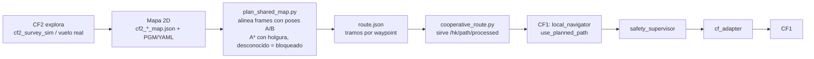
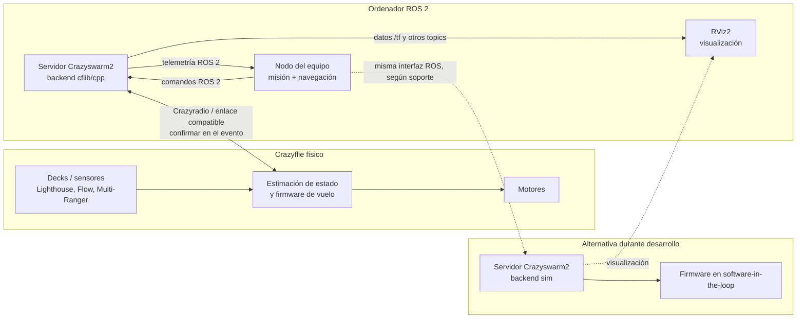
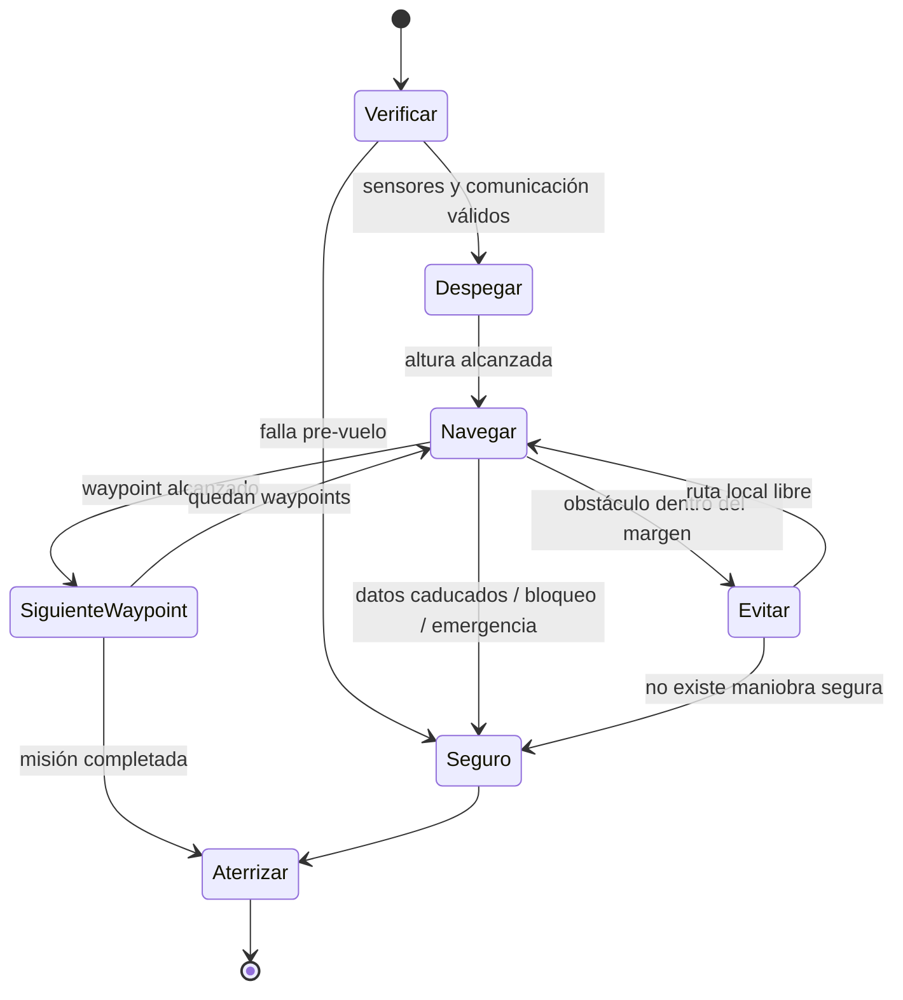

# Mobile Robotics Hackathon — Crazyflie Autonomous Navigation

Solución de nuestro equipo para el reto **Autonomous Navigation** de la Mobile Robotics Hackathon 2026, TU Dresden, 10–11 de octubre de 2026: dos Crazyflie que cooperan sobre ROS 2 Humble y Crazyswarm2.

## Proyecto final: dos drones que cooperan

| | CF1 — navegación | CF2 — mapeo |
|---|---|---|
| Decks | Lighthouse + Flow | Flow + Multi-ranger (ToF) |
| Localización | Lighthouse (frame `map` absoluto) | Flow (odometría relativa a su despegue) |
| Función | Misión de waypoints con planificación, seguimiento de ruta y supervisor de seguridad | Explora un entorno desconocido y genera un mapa de ocupación 2D |
| Código principal | `mission_manager`, `local_navigator`, `safety_supervisor`, `cf_adapter` (`flow_only`) | `scripts/cf2_*.py`, `global_planner`, `local_navigator` (evasión TP-34/35/36) |
| Documentación | [interfaces](docs/interfaces.md), [runbook](docs/hackathon_day_runbook.md) | [cobertura y exportación](docs/cf2_coverage_demo.md), [simulación](docs/cf2_survey_simulation.md) |

### Flujo cooperativo CF2 → CF1



El CF2 mapea; el CF1 planifica su ruta sobre ese mapa (nunca trata el espacio desconocido como libre) y la sigue tramo a tramo, en orden, a la altura de la capa medida.

### Cómo ejecutarlo en simulación (sin radio ni hardware)

En Ubuntu 22.04 / WSL 2 con ROS 2 Humble y Crazyswarm2:

```bash
bash scripts/build.sh && source ros2_ws/install/setup.bash

# CF2: exploración y mapa 2D (con ventanas: bash scripts/cf2_sim_rviz.sh --scenario obstacles)
python3 scripts/cf2_survey_sim.py --scenario obstacles --headless
python3 scripts/cf2_export_map.py data/runs/cf2_sim_<sesión>_map.json

# CF1: planificar sobre el mapa del CF2 (referencias A/B: docs/cf2_coverage_demo.md)
python3 scripts/plan_shared_map.py --map data/runs/cf2_sim_<sesión>_map.json --mission <misión.yaml> \
  --reference-a <A.json> --reference-b <B.json> --start <x> <y> <z> --robot-radius 0.10 \
  --output route.json --allow-simulation

# CF1: volar la ruta en el stack completo (API de Crazyswarm2 emulada)
ros2 launch hackathon_bringup simulation_cf.launch.py scenario:=T17_cooperative_route
ros2 launch hackathon_bringup simulation_cf.launch.py scenario:=<escenario> route:=route.json

# Verificación de punta a punta (pose → salud → misión → navegación → safety → cf_adapter → aterrizaje)
python3 scripts/verify_mvp_integration.py --scenario T17_cooperative_route
```

### Verificación (simulación, 31/10/2026)

| Prueba | Resultado |
|---|---|
| `colcon test` (14 paquetes) | 223 tests, 0 fallos (28 omitidos) |
| Scripts `scripts/test_*.py` (CF2 y ruta cooperativa) | 77 tests, todos pasan |
| `verify_mvp_integration.py`: T01, T02, T04 | PASS |
| `verify_mvp_integration.py`: T17 ruta cooperativa | PASS |
| CF2 `cf2_survey_sim.py` vacío / con obstáculos | 28/28 objetivos, 83,8 % / 82,2 % observado |
| Bucle completo: mapa del CF2 → `plan_shared_map` → vuelo del CF1 | PASS en ambos mapas (5 tramos, 0,3 m, holgura 0,15 m) |

### Limitaciones conocidas

- **Solo simulación.** El simulador del CF2 es ideal y el emulador del CF1 es cinemático; no modelan deriva del Flow, latencia de radio ni dinámica real. Alinear el mapa del CF2 con el frame Lighthouse requiere las poses medidas A/B del día del vuelo.
- **Sin implementar desde el inicio del proyecto:** `local_world_model` (mapa de obstáculos propio del CF1), `telemetry` y el evaluador `hackathon_tests/run_scenario`. Por eso `T03_static_wall` (rodear un muro no mapeado con `planner_mode: astar`) falla y `run_all_scenarios.sh` no produce PASS/FAIL. Para el CF1, el conocimiento de obstáculos llega por el mapa del CF2.
- **Ruta cooperativa:** el CF1 mantiene su orientación inicial y sigue la ruta con un zigzag de unos 10 cm por la grilla de 5 cm, dentro de la holgura. En el emulador, el arranque falló una vez de forma intermitente por llegada tardía de rangos.

> **Historial:** las ramas `tp*`, `integration-mvp-crazyswarm` (CF1) e `integration/cf2-navigation-mapping` (CF2) se conservan como respaldo. El resto de este README es la planificación previa al evento. Roadmap detallado: [docs/roadmap.md](docs/roadmap.md).

## Objetivo del reto

La descripción del reto pide guiar un dron, AGV o rover por *waypoints* usando percepción; localizarse, planificar y ejecutar trayectorias sin colisiones en escenas con cambios de iluminación, pocos rasgos visuales y elementos dinámicos. El objetivo inicial del equipo es demostrar una solución pequeña, segura y repetible con Crazyflie.

La organización anuncia 20 Crazyflie 2.1 Brushless y decks Lighthouse, Optical Flow y Multi Ranger, además de NUCs, un NVIDIA Jetson AGX Orin y red 5G en el recinto. La página no especifica qué sensores estarán montados en cada dron, si habrá cámaras, ni qué interfaz de sensores/ROS estará preparada. **Confirmar esos detalles con los mentores antes de elegir la arquitectura final.**

Fuentes: [reto Autonomous Navigation](https://mobile-robotics.eu/#challenges) · [plataformas y equipamiento](https://mobile-robotics.eu/#tech-equipment) · [FAQ (qué llevar)](https://mobile-robotics.eu/#faq)

## Esquema general del sistema

ROS 2 conecta procesos llamados nodos mediante topics, services y actions. Crazyswarm2 proporciona el servidor y la interfaz ROS para hablar con los Crazyflies. El nodo de navegación del equipo decidirá qué hacer; el firmware del Crazyflie mantiene el control de vuelo de bajo nivel. RViz es una herramienta de visualización, no el controlador ni necesariamente un simulador físico.



El diagrama representa la arquitectura objetivo, no confirma que todos los sensores publiquen ya los topics necesarios en nuestro entorno. En hardware real, el servidor se conecta a Crazyflies mediante uno o varios Crazyradio; en `sim`, el backend simulado sustituye ese enlace. Crazyswarm2 ofrece servicios de alto nivel como despegue, aterrizaje y `go_to`, además de comandos de estado completo según el backend.

### Recorrido de una orden

1. Un nodo de misión determina el siguiente *waypoint*.
2. El planificador consulta la posición y las mediciones de obstáculos disponibles.
3. El controlador de navegación decide avanzar, rodear un obstáculo, esperar o aterrizar.
4. El nodo envía una orden por la interfaz ROS de Crazyswarm2.
5. El servidor la entrega al backend: simulador o conexión de radio al Crazyflie.
6. El firmware ejecuta el control de vuelo; sensores/estado pueden regresar al host como telemetría ROS.
7. RViz escucha topics de visualización (por ejemplo, transformaciones `/tf` y, cuando estén configurados, pose o sensores) y los dibuja.

**RViz no está en el lazo de control.** Su ventana puede ayudar a depurar y presentar, pero el resultado del dron depende de los nodos de control, de la estimación y del hardware.

## Crazyflie y sensores anunciados

| Componente | Para qué sirve | Dependencias / límites que debemos confirmar |
|---|---|---|
| Crazyflie 2.1 Brushless | Plataforma voladora y firmware que estabiliza el vuelo y acciona motores. | Confirmar acceso, firmware y procedimiento de seguridad con mentores. |
| Lighthouse deck | Posición en el espacio a partir de estaciones base Lighthouse; la estimación se realiza en el Crazyflie. | Requiere deck, estaciones base configuradas y línea de vista. Confirmar si las estaciones y geometría estarán listas. |
| Flow deck / Optical Flow | Estima movimiento relativo al suelo; combinado con medida de altura ayuda a la estimación de movimiento/altura. | Depende de las condiciones de superficie y altura; no es una cámara para reconocer obstáculos. |
| Multi-Ranger | Mide distancia en cinco direcciones: delante, detrás, izquierda, derecha y arriba. | Es percepción de rango dispersa, no un escáner denso 360°; comprobar topic/tasa y límites reales. |
| Cámara | No aparece especificada en la lista de Crazyflies de la página del evento. | No planear visión por cámara hasta confirmar que estará disponible y accesible. |
| Crazyradio / radio | Enlace típico del ordenador de control al Crazyflie. | Confirmar qué radio, ordenador y backend usarán. WSL 2 no garantiza acceso directo al USB del radio. |

Referencias: [Lighthouse](https://www.bitcraze.io/documentation/system/positioning/) · [Flow Deck](https://www.bitcraze.io/products/flow-deck-v2/) · [Multi-Ranger](https://www.bitcraze.io/multi-ranger-deck/) · [arquitectura de Crazyswarm2](https://imrclab.github.io/crazyswarm2/overview.html)

## Software y función

| Software | Función en el proyecto |
|---|---|
| Ubuntu 22.04 (WSL 2) | Entorno Linux actual de desarrollo en la laptop. |
| ROS 2 Humble | Middleware y herramientas: nodos, topics, services, configuración y lanzamiento. |
| Crazyswarm2 | Servidor y API ROS 2 que abstraen control de Crazyflies y permiten usar diferentes backends. |
| Crazyflie firmware / `cffirmware` | Firmware y bindings empleados por la simulación SIL; no es el algoritmo de navegación del equipo. |
| `rowan` | Dependencia Python que necesitaba el servidor simulado en esta instalación. |
| RViz2 | Inspección de transforms, modelos y datos ROS configurados. No calcula rutas ni controla motores. |
| Git + GitHub | Control de versiones, colaboración y documentación del prototipo. |
| `acados` | **No es requisito del MVP.** Considerarlo solo si, después de validar sensores, hay una razón concreta para optimización/MPC y tiempo para integrarlo. |

## Estado de preparación

### Validado

- [x] WSL 2 con Ubuntu 22.04 y usuario Linux configurado.
- [x] ROS 2 Humble instalado y configurado; previamente se verificó la comunicación básica de ROS 2.
- [x] Paquetes ROS de Crazyflie/Crazyswarm2 instalados.
- [x] Dependencias que bloqueaban la simulación resueltas: bindings `cffirmware` y módulo `rowan`.
- [x] Ejecución de `hello_world` con el backend `sim`: el log registró despegue y aterrizaje.
- [x] RViz2 abrió añadiendo `rviz:=True` al lanzamiento.
- [x] Vimos nodos como `/crazyflie_server`, `/teleop`, `/joy_node` y `/rviz2` durante la prueba.
- [x] Comprobamos que `/tf` tenía un publicador y suscriptor, y que `/cf231/cmd_full_state` no tenía publicadores una vez finalizado el ejemplo.
- [x] Repositorio local inicializado en la rama `main`; `origin` configurado por SSH según comprobación del usuario.

### Pendiente — prioridad alta

Preguntas para mentores (no bloquean el desarrollo gracias a la capa de abstracción, TP-09/TP-10):

- [ ] Preguntar qué Crazyflie/deck se asignará y qué sensores estarán realmente montados.
- [ ] Confirmar fuente de localización (Lighthouse/Flow u otra), datos ROS disponibles, nombres/tipos de topics y tasa de actualización.
- [ ] Confirmar si el equipo debe usar su laptop, un NUC o Jetson; backend previsto (`cflib`, `cpp` o `sim`) y acceso al radio.

Desarrollo (el detalle está en [docs/roadmap.md](docs/roadmap.md)):

- [x] API propia y `cf_adapter`, verificados con mocks ROS y SIL (TP-09); validación con hardware real pendiente.
- [x] Simulador propio con pose y seis rangos sintéticos (TP-10); 79 pruebas pasan, repetir con `bash scripts/verify_tp10.sh`.
- [ ] Nodo propio de misión/navegación y configuración de *waypoints* (TP-26, TP-32).
- [ ] Primera política de evitación apropiada a los sensores reales (TP-19, TP-20, TP-34) y comportamiento seguro ante datos perdidos (TP-15, TP-37, TP-38, TP-39).
- [ ] Probar integración con un Crazyflie real bajo supervisión y espacio de vuelo autorizado (runbook del roadmap).
- [ ] Medir resultados y preparar demo/presentación.

### Limitación actual de la simulación

La prueba actual sirve como **smoke test** de lanzamiento, servicios de alto nivel y visualización. En la inspección que hicimos no aparecieron topics de pose/rango como `/cf231/pose` o `/scan`, y `/cf231/cmd_full_state` tenía cero publicadores al terminar `hello_world`. Por lo tanto, todavía no se ha validado percepción, localización autónoma, planificación ni evitación de obstáculos. Comprobar los endpoints durante un vuelo activo y con el backend/sensores que se vayan a usar.

Para no depender de esto, el roadmap añade un `simulation_adapter` propio (TP-10) que publica pose y rangos sintéticos del Multi-ranger con la misma API que usará el adapter de hardware.

## MVP propuesto

La primera solución debería privilegiar que funcione repetidamente antes que complejidad algorítmica:

1. **Despegue/aterrizaje seguro:** secuencia oficial de Crazyswarm2, zona y altura acordadas, parada de emergencia conocida.
2. **Navegación a waypoint:** mover a coordenadas si hay localización válida; validar llegada con tolerancia y tiempo límite.
3. **Percepción mínima de obstáculos:** usar la fuente confirmada (por ejemplo, distancias Multi-Ranger); filtrar lecturas inválidas/obsoletas.
4. **Evitación sencilla:** detenerse y elegir una dirección libre o rodear un obstáculo usando las medidas disponibles. No asumir mapa 3D completo con cinco rayos.
5. **Recuperación segura:** si no hay posición, el sensor no actualiza o el plan se bloquea, frenar/estabilizar y aterrizar según protocolo acordado.
6. **Repetibilidad:** correr la misión varias veces, guardar logs y reportar claramente fallos y limitaciones.

Una máquina de estados inicial puede ser:



Los umbrales de distancia, altura y velocidad deben definirse con los mentores, el espacio disponible y el deck instalado; no se fijan aquí valores arbitrarios (todos van en YAML; lista en el roadmap, "Parámetros configurables").

Esta máquina de estados es la capa de **misión**. El roadmap añade dos capas independientes por debajo: la **salud de la localización** (`GOOD`/`DEGRADED`/`LOST`) y el **Safety Supervisor** (`NORMAL`/`SLOW`/`HOVER`/`LAND`/`ABORT`), que puede anular la navegación normal en cualquier estado.

## Roadmap

El roadmap completo de 0–100% está en [docs/roadmap.md](docs/roadmap.md): arquitectura por módulos y paquetes ROS 2, los 42 TPs con su DoD, la test matrix T01–T18 y el runbook del día del evento. Como no da tiempo a hacer los 42 TPs antes del 10 de octubre, cada TP tiene una prioridad: **P0** = MVP imprescindible, **P1** = si sobra tiempo, **P2** = solo si todo está estable.

| Bloque | Rango | Contenido | Estado |
|---|---|---|---|
| A | 0–12% | Entorno, WSL, GitHub, ROS 2, workspace | ✅ |
| B | 12–25% | Crazyswarm2, interfaz de hardware, simulador propio, bringup | 🟡 |
| C | 25–39% | Frames, estado, salud de localización, altura | ⬜ |
| D | 39–55% | Modelo y filtrado del Multi-ranger, mapa local | ⬜ |
| E | 55–70% | Mission Manager, A*, replanning | ⬜ |
| F | 70–82% | Path follower, evitación reactiva | ⬜ |
| G | 82–94% | Safety Supervisor, watchdogs, geofence, rosbag, fault injection | ⬜ |
| H | 94–100% | Ubuntu nativo, `event.yaml`, runbook | ⬜ |

Al terminar un TP, actualizar su casilla en `docs/roadmap.md` y, si cambia el estado de un bloque, también esta tabla.

## Estructura del repositorio

```text
.
├── README.md
├── docs/
│   ├── roadmap.md          # TP-01..TP-42, prioridades, test matrix, runbook
│   ├── interfaces.md       # contrato de topics, mensajes, servicios y TF entre paquetes
│   └── simulations.md      # niveles de simulación, escenarios y cómo evaluarlos
├── ros2_ws/src/
│   ├── hackathon_interfaces/   # msg/srv propios (MultiRange, Setpoint, SafetyState, ...)
│   ├── hackathon_bringup/
│   │   ├── launch/             # simulation.launch.py, real.launch.py
│   │   └── config/             # simulation/event/conservative/cs2_sim.yaml, frames.yaml,
│   │                           # worlds/, missions/, scenarios/ (T01–T16)
│   ├── simulation_adapter/     # simulador propio: mundo, raycast, dinámica, fallos
│   ├── cf_adapter/             # único paquete que habla con Crazyswarm2
│   ├── state_monitor/          # estado único + salud de la localización
│   ├── range_processor/        # validación/filtro del Multi-ranger, d_dot
│   ├── local_world_model/      # rolling occupancy grid
│   ├── mission_manager/        # waypoints + máquina de estados de misión
│   ├── global_planner/         # ruta directa (P0) o A* (P1) + replan
│   ├── path_processor/         # simplificación de ruta
│   ├── local_navigator/        # path follower + evitación reactiva
│   ├── safety_supervisor/      # NORMAL/SLOW/HOVER/LAND/ABORT, watchdogs, geofence
│   ├── telemetry/              # métricas por ejecución
│   └── hackathon_tests/        # evaluador pass/fail de escenarios
├── scripts/                # build.sh, record_bag.sh, run_all_scenarios.sh
└── data/                   # bags y resultados locales (fuera de Git)
```

Cada paquete Python sigue el mismo patrón: un `*_node.py` que conecta ROS y uno o más **módulos de lógica pura** (sin `rclpy`) con tests en `test/`. `cf_adapter` ya implementa TP-09 y tiene pruebas de conversiones, comunicación ROS y conexión al SIL. `simulation_adapter` implementa TP-10 con movimiento, servicios de vuelo, mundo YAML y rangos por raycast. `mission_manager` incorpora TP-26 de main con 8 pruebas de lógica. Los demás paquetes siguen mayormente como esqueletos con lógica pendiente y tests marcados como `skip`.

### Mapa del código a escribir

| Paquete | Módulos de lógica | TPs | Rol | Prioridad |
|---|---|---|---|---|
| `simulation_adapter` | `world.py`, `dynamics.py`, `faults.py` | TP-10, TP-41 | Integración | P0 (lo primero) |
| `state_monitor` | `health.py` | TP-13–TP-17 | Percepción | P0 |
| `range_processor` | `range_filter.py`, `rays.py` | TP-19–TP-21, TP-36 | Percepción | P0 |
| `mission_manager` | `mission.py` | TP-26 | Navegación | P0 |
| `global_planner` | `astar.py` (`direct_path` es P0), `replan.py` | TP-27–TP-29 | Navegación | P0 / P1 |
| `local_navigator` | `follower.py`, `avoidance.py` | TP-32–TP-36 | Navegación | P0 |
| `safety_supervisor` | `supervisor.py`, `watchdog.py`, `geofence.py` | TP-37–TP-39 | Navegación | P0 |
| `telemetry` | `metrics.py` | TP-40 | Integración | P0 (para evaluar) |
| `hackathon_tests` | `scenario.py` | TP-31, TP-41 | Integración | P0 |
| `cf_adapter` | `mapping.py` | TP-08, TP-09 | Integración | P0 (tras TP-08) |
| `local_world_model` | `grid.py` | TP-22–TP-25 | Percepción | P1 |
| `path_processor` | `simplify.py` | TP-30 | Navegación | P1 |

Para empezar a trabajar:

```bash
# En WSL, con el repo clonado dentro de ~/ (TP-03)
bash scripts/build.sh
source ros2_ws/install/setup.bash
ros2 launch hackathon_bringup simulation.launch.py scenario:=T01_single_waypoint
```

TP-12 verificado: arranca los 16 nodos y conecta pose, estado, rangos y TF; Ctrl+C
cierra el bringup. Para repetir: `ROS_DOMAIN_ID=92 /usr/bin/python3 scripts/verify_tp12.py`
(después de cargar ROS e `install/setup.bash`). TP-26 de misión está implementado; navegación y seguridad siguen en desarrollo.
El arranque no implica una misión autónoma.

Configuración y preparación del evento: [runbook](docs/hackathon_day_runbook.md).
Validar la plantilla con `/usr/bin/python3 scripts/verify_event_config.py`; completar
identidad/radio y confirmar valores físicos antes de usar `--ready`.

## Plan del equipo

### Antes del evento (4–9 de octubre)

Solo TPs **P0**. Cada día termina con una *vertical slice* ejecutable.

| Día | TPs | Resultado esperado |
|---|---|---|
| 4 oct | TP-01, TP-03, TP-04 | README, roadmap, matriz de entorno, repo clonado dentro de WSL, flujo de PR probado. |
| 5 oct | TP-06, TP-08, TP-09 | Workspace `ros2_ws`, `hackathon_interfaces`, documento de comandos Crazyflie, API propia de hardware; sin acoplarse a un sensor no confirmado. |
| 6 oct | TP-10, TP-12, TP-13, TP-14 | Simulador propio (pose + rangos sintéticos), `simulation.launch.py`, frames, topic de estado único. **VS-1.** |
| 7 oct | TP-15, TP-17, TP-19, TP-20, TP-26, TP-32 | Salud de localización, banda de altura, filtrado de rangos, misión por waypoints sin obstáculos. **VS-2.** |
| 8 oct | TP-34, TP-37, TP-38, TP-39 | Evitación reactiva, Safety Supervisor, watchdogs, geofence; pruebas de llegada, lecturas inválidas, obstáculo y timeout (T01, T02, T05, T08–T16). |
| 9 oct | TP-42 C/E | `config/event.yaml`, runbook, congelar dependencias, README de instalación, preguntas para mentores, ensayo, video de respaldo y estructura de demo/pitch. Sin cambios grandes de última hora. |

El mapa de ocupación + A* (TP-22 a TP-31) es **P1**: solo si la slice P0 está estable. El MVP no lo necesita.

### Durante la hackaton (10–11 de octubre)

1. **Kickoff:** confirmar criterios, pista, sensores, computador de control, radio, seguridad y API de ROS.
2. **Baseline:** ejecutar un ejemplo proporcionado en el hardware real; no empezar volando código nuevo.
3. **Integración incremental:** seguir el [runbook de 14 pasos](docs/roadmap.md#runbook-del-día-del-evento) (radio → Lighthouse → Flow → Multi-ranger → frames → hover → waypoints → obstáculos → tuning → congelar configuración). Si el stack está bien desacoplado, el cambio de simulador a hardware se limita a `cf_adapter`, configuración y tuning (VS-5).
4. **Ensayos:** medir cada intento, registrar logs y volver a la última versión estable después de cualquier cambio riesgoso.
5. **Presentación:** enseñar el problema, sensores, arquitectura, demo, métricas y límites conocidos.

El programa publicado sitúa la selección/explicación de retos el sábado por la mañana y las presentaciones finales el domingo a las 17:00. Revisar el sitio por si cambia. [Agenda oficial](https://mobile-robotics.eu/#agenda)

### Roles sugeridos para 3 personas

- **Percepción/localización:** identificar sensores, validar datos y documentar frames/unidades/tasas. Módulos 2–4: `state_monitor`, `range_processor`, `local_world_model`.
- **Navegación/control:** waypoint, máquina de estados, evitación y lógica de seguridad. Módulos 0 y 5–8: `mission_manager`, `global_planner`, `path_processor`, `local_navigator`, `safety_supervisor`.
- **Integración/demo:** ROS launch, conexión con Crazyswarm2, pruebas, métricas, README y pitch. Módulos 1 y 9: `cf_adapter`, `simulation_adapter`, `hackathon_bringup`, `telemetry`, `hackathon_tests`.

Todos deben poder explicar el sistema y ejecutar la demo; evitar que una sola persona conozca la integración completa.

## Métricas para la demo y presentación

Registrar como mínimo:

- waypoints completados / waypoints intentados;
- colisiones o intervenciones manuales;
- tiempo total de misión;
- distancia mínima observada al obstáculo, si el sensor permite medirla;
- número de replans, eventos de estado vencido e intervenciones del Safety Supervisor;
- número de ensayos repetidos con éxito;
- resultado de la [test matrix T01–T18](docs/roadmap.md#test-matrix-mínima) en simulación;
- limitaciones conocidas (oclusiones, lecturas inválidas, espacio, baja resolución del sensor).

No afirmar “autónomo y robusto” solo porque el dron se movió una vez. Mostrar evidencia y explicar condiciones de prueba.

## Qué llevar

La organización indica llevar **portátil y cargador**; robots, drones, impresoras 3D y herramientas se proporcionan en el sitio. Recomendado adicionalmente: acceso al repositorio/GitHub, copia local del código, extensiones/cargador adecuados y una grabación de respaldo de la simulación. No comprar hardware antes de preguntar qué estará disponible.

**Nota WSL 2:** la simulación gráfica funcionó en la laptop, pero eso no verifica que un dongle USB de radio pueda usarse desde WSL. Si el control real depende de ese USB, confirmar si se usará un NUC/Jetson preparado por la organización o cómo darán acceso al dispositivo. La red 5G del recinto no debe asumirse como enlace de control del Crazyflie.

## Comandos de referencia

Lanzar el ejemplo simulado con visualización (terminal Ubuntu):

```bash
ros2 launch crazyflie_examples launch.py script:=hello_world backend:=sim rviz:=True
```

Inspección básica mientras el lanzamiento sigue activo, desde otra terminal Ubuntu:

```bash
ros2 node list
ros2 topic list
ros2 topic info /tf --verbose
ros2 service list
```

Stack propio (más detalle en [docs/simulations.md](docs/simulations.md)):

```bash
bash scripts/build.sh && source ros2_ws/install/setup.bash
cd ros2_ws && colcon test && colcon test-result --verbose && cd ..        # nivel 0: tests unitarios
ros2 launch hackathon_bringup simulation.launch.py scenario:=T05_popup_obstacle rviz:=true
ros2 launch hackathon_bringup simulation.launch.py scenario:=T09_range_dropout evaluate:=true
bash scripts/run_all_scenarios.sh                                         # toda la matriz
```

Antes de compartir logs, revisar que no contengan datos privados. No guardar claves SSH, tokens ni archivos `.env` en el repositorio.

## Referencias

- [Mobile Robotics Hackathon 2026](https://mobile-robotics.eu/)
- [Crazyswarm2 — Overview](https://imrclab.github.io/crazyswarm2/overview.html)
- [Crazyswarm2 — Usage](https://imrclab.github.io/crazyswarm2/usage.html)
- [Bitcraze — positioning systems](https://www.bitcraze.io/documentation/system/positioning/)
- [Bitcraze — Flow Deck V2](https://www.bitcraze.io/products/flow-deck-v2/)
- [Bitcraze — Multi-Ranger](https://www.bitcraze.io/multi-ranger-deck/)

---

Documento vivo del equipo. Actualizar las casillas de estado, los sensores confirmados y la arquitectura real en cuanto los mentores den detalles.

For a drone-free, one-height fixed zigzag with live RViz mapping, see
[CF2 survey simulation](docs/cf2_survey_simulation.md). The simulator uses static
scenarios and distinguishes ideal simulated results from hardware validation.
