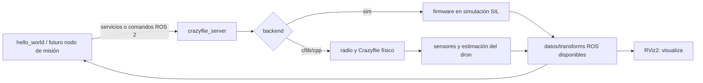

# Estado de instalación y validación — WSL 2 + ROS 2 + Crazyswarm2

Documento complementario al [README principal](README.md). Su propósito es que el equipo pueda reproducir el punto de partida y distinguir lo validado de lo pendiente.

> **Resumen:** se validó una instalación de Ubuntu 22.04 sobre WSL 2 con ROS 2 Humble y Crazyswarm2. El ejemplo `hello_world` funcionó con el backend `sim` y pudo visualizarse en RViz2 al activar `rviz:=True`. **Aún no** se implementó navegación autónoma propia ni se probó el enlace con un Crazyflie físico.

## 1. Entorno validado

| Elemento | Estado observado |
|---|---|
| Windows + WSL 2 | Ubuntu 22.04 instalado y ejecutándose bajo WSL 2. |
| Usuario Linux | `asus` en la laptop de desarrollo. Otros colaboradores tendrán sus propios usuarios. |
| Almacenamiento de Ubuntu | La distribución se movió a `E:\WSL\Ubuntu-22.04` para conservar espacio en C:. |
| ROS 2 | ROS 2 Humble Desktop instalado en Ubuntu 22.04. |
| Crazyswarm2 | Paquetes binarios `ros-humble-crazyflie*` instalados desde apt. |
| Bindings firmware | `cffirmware` se hizo importable en Python y dejó de bloquear el servidor simulado. |
| Dependencia Python | `rowan` se instaló para el servidor simulado. |
| RViz2 | Abrió en WSLg al lanzar con `rviz:=True`. |
| GitHub | Repositorio remoto `Comentario/mobile-robotics-hackathon-crazyflie`, rama local `main`; el usuario comprobó autenticación SSH y que `origin` aparece. |

La instalación de Python fue resuelta manualmente en la laptop original; no hay todavía un script de provisión verificado para recrear todo desde cero en los equipos de los colaboradores.

## 2. Arranque del entorno ROS 2

Abrir Ubuntu 22.04 (WSL) y comprobar ROS 2:

```bash
source /opt/ros/humble/setup.bash
echo "$ROS_DISTRO"
ros2 --help
```

Se espera que `echo "$ROS_DISTRO"` muestre `humble`. Si `source` se ejecuta en una terminal nueva, aplica solo a esa terminal. En la laptop original se configuró el entorno para las sesiones Ubuntu; cada colaborador debe verificar su propia instalación.

Comprobar que los paquetes Crazyflie están instalados:

```bash
ros2 pkg list | grep '^crazyflie'
```

La instalación original mostró paquetes como `crazyflie`, `crazyflie_description`, `crazyflie_examples`, `crazyflie_interfaces`, `crazyflie_py`, `crazyflie_server_cpp`, `crazyflie_server_py` y `crazyflie_sim`.

## 3. Dependencias de la simulación que se resolvieron

### `cffirmware`

Al inicio, el servidor terminó con `ModuleNotFoundError: No module named 'cffirmware'`. Se prepararon y compilaron los bindings Python del firmware Crazyflie en `~/crazyflie-firmware`; tras resolver ese módulo, el servidor pudo avanzar a la siguiente dependencia. En el entorno original se llegó a verificar la importación de `cffirmware`.

Comprobación para la laptop original:

```bash
python3 -c "import cffirmware; print('cffirmware listo')"
```

La ruta de construcción del firmware estaba en `~/crazyflie-firmware/build`. Si el import falla en una terminal nueva, revisar el entorno Python y la ruta real antes de recompilar:

```bash
export PYTHONPATH="$HOME/crazyflie-firmware/build${PYTHONPATH:+:$PYTHONPATH}"
python3 -c "import cffirmware; print('cffirmware listo')"
```

Esta ruta es específica de la instalación que se hizo en la laptop original; no asumir que ya existe en otro computador.

### `rowan`

Después apareció `ModuleNotFoundError: No module named 'rowan'`. Como `pip` no estaba instalado, se instaló `python3-pip` y luego `rowan` para el usuario Linux.

```bash
python3 -m pip install --user rowan
python3 -c "import rowan; print('rowan listo')"
```

No se guarda un entorno virtual ni una lista completa de dependencias Python en el repositorio todavía; esta es una instalación manual confirmada en el entorno original.

## 4. Simulación que sí se ejecutó

En Ubuntu, iniciar:

```bash
ros2 launch crazyflie_examples launch.py script:=hello_world backend:=sim rviz:=True
```

Resultado observado:

- El launch inició el servidor `crazyflie_server`, `teleop`, `joy_node`, `hello_world` y RViz2.
- El servidor registró `takeoff(height=1.0 m, duration=2.5 s)` y, posteriormente, `land(...)` para `cf231`.
- `hello_world` terminó limpiamente.
- RViz2 mostró la visualización cuando se usó `rviz:=True`.

La opción `rviz:=True` fue necesaria en este lanzamiento; sin ella no apareció la ventana. El mensaje `Stereo is NOT SUPPORTED` no impidió visualizar y no se relacionó con audio. La salida también mostró OpenGL 4.2.

Esta prueba confirma que el ejemplo y el backend simulado arrancan en esa laptop. No demuestra que la percepción del reto funcione ni que el vuelo físico esté preparado.

## 5. Observación ROS que se realizó

Durante la ejecución, `ros2 node list` mostró nodos como:

```text
/crazyflie_server
/joy_node
/rviz2
/teleop
```

La lista de topics observada incluyó:

```text
/cf231/cmd_full_state
/cf231/cmd_hover
/cf231/cmd_vel_legacy
/cf231/robot_description
/clock
/joy
/tf
/tf_static
```

Al consultar:

```bash
ros2 topic info /tf
ros2 topic info /cf231/cmd_full_state
```

se obtuvo:

```text
/tf: Publisher count 1, Subscription count 1
/cf231/cmd_full_state: Publisher count 0, Subscription count 1
```

La consulta se hizo tras la secuencia de `hello_world`. Un topic puede existir aunque en ese instante nadie publique datos. La lista observada **no incluyó** `/cf231/pose` ni `/cf231/scan`; por ello no se ha validado todavía un flujo de percepción/localización para navegación. Para identificar qué nodos son los endpoints y revisar servicios, usar durante una ejecución activa:

```bash
ros2 topic info /tf --verbose
ros2 topic list
ros2 service list
```

## 6. Modelo mental de los componentes



ROS 2 proporciona la comunicación entre nodos. Crazyswarm2 define la interfaz y el servidor del Crazyflie. El backend `sim` es una alternativa al enlace físico. RViz consume datos para mostrarlos; no decide la ruta ni hace el control de vuelo.

## 7. Lo que todavía falta

### Para que cada colaborador pueda reproducir la base

- [ ] Documentar versiones exactas de WSL, Ubuntu, ROS 2, paquetes apt y firmware/bindings.
- [ ] Preparar instrucciones limpias de instalación para otro usuario Linux; no depender del `PYTHONPATH` personal de `asus`.
- [ ] Decidir si el repositorio se usará desde `/mnt/e/...` o si el código fuente ROS tendrá una copia/clon dentro del filesystem Linux (recomendable para builds frecuentes con `colcon`).
- [ ] Verificar el README y este documento en GitHub después del primer commit/push.

### Para el reto y el hardware real

- [ ] Confirmar con mentores qué deck lleva el dron asignado y qué topics/sensores están disponibles.
- [ ] Confirmar si Lighthouse y estaciones base, Optical Flow, Multi-Ranger o cámara estarán disponibles y configurados.
- [ ] Confirmar el ordenador y backend que se usarán (`cflib`/`cpp`) y el acceso al Crazyradio; WSL USB no ha sido probado.
- [ ] Inspeccionar datos en hardware: unidades, frecuencia, frames, calidad de posición y comportamiento ante lecturas inválidas.
- [ ] Implementar el nodo de misión: waypoints, máquina de estados, timeout y aterrizaje seguro.
- [ ] Implementar y probar evitación de obstáculos acorde al sensor real.
- [ ] Hacer pruebas físicas supervisadas, repetibles y en el área autorizada.
- [ ] Registrar métricas y preparar demo/presentación con límites conocidos.

## 8. Siguiente sesión sugerida

1. Revisar que el README principal y este archivo estén en GitHub.
2. En una terminal Ubuntu activa, volver a lanzar la simulación y abrir otra terminal para listar nodos/topics/servicios.
3. Crear una tabla de datos requeridos por el nodo de navegación: posición, distancias, comandos, unidades, frecuencia y frame.
4. Llevar esa tabla a los mentores para confirmar qué proporciona el setup real antes de escoger algoritmo.

## Referencias

- [Crazyswarm2 — instalación](https://imrclab.github.io/crazyswarm2/installation.html)
- [Crazyswarm2 — uso y simulación](https://imrclab.github.io/crazyswarm2/usage.html)
- [Crazyswarm2 — overview de paquetes y backends](https://imrclab.github.io/crazyswarm2/overview.html)
- [Reto y equipamiento de la hackaton](https://mobile-robotics.eu/)

---

## Guía detallada desde cero

Esta guía describe cómo preparar un ordenador Windows con WSL 2, Ubuntu 22.04, ROS 2 Humble, Crazyswarm2, simulación y RViz2. Está pensada para alguien que nunca ha instalado ROS. Las secciones anteriores conservan el estado y los resultados observados en la laptop original.

### Antes de empezar: qué terminal usar

Hay dos terminales distintas. No mezclar sus comandos:

- **PowerShell de Windows:** comandos como wsl y New-Item. Abrir desde Inicio buscando PowerShell. Para instalar WSL por primera vez, abrirlo como administrador.
- **Ubuntu (WSL):** terminal Linux; los comandos usan sudo, apt, cd, source, make y ros2. La contraseña Linux no muestra caracteres mientras se escribe: es normal.

El usuario Linux debe empezar con minúscula. En la laptop original, ASUS fue rechazado; asus sí funcionó. El usuario y contraseña de Ubuntu son locales a esa distribución y no tienen que coincidir con Windows.

### 1. Instalar o comprobar WSL 2 y Ubuntu 22.04

En PowerShell como administrador:

    wsl --install
    wsl --update
    wsl --set-default-version 2
    wsl --install -d Ubuntu-22.04

Si Windows pide reiniciar, hacerlo. Abrir Ubuntu desde el menú Inicio y crear el usuario Linux.

Comprobar desde PowerShell:

    wsl --status
    wsl --version
    wsl --list --verbose

En la lista, Ubuntu-22.04 debe mostrar VERSION 2. Si aparece VERSION 1:

    wsl --set-version Ubuntu-22.04 2

Después comprobar desde Ubuntu:

    whoami
    lsb_release -a
    uname -m

Se espera Ubuntu 22.04 (Jammy) y arquitectura x86_64/amd64 en una laptop Intel/AMD habitual.

Referencias Microsoft: [instalar WSL](https://learn.microsoft.com/windows/wsl/install) · [comandos WSL](https://learn.microsoft.com/windows/wsl/basic-commands)

### 2. Opcional: mover Ubuntu a otro disco antes de instalar ROS

Ubuntu vive dentro de un disco virtual que normalmente ocupa espacio en C:. Si C: tiene poco espacio y se dispone de otro disco (en nuestro caso E:), conviene mover la distribución antes de instalar paquetes grandes.

En PowerShell, crear el directorio padre:

    New-Item -ItemType Directory -Path E:\WSL -Force

Cerrar todas las ventanas de Ubuntu y aplicaciones que puedan mantener WSL ocupado (por ejemplo, VS Code conectado a WSL o Docker Desktop). Luego:

    wsl --shutdown
    wsl --list --verbose
    wsl --manage Ubuntu-22.04 --move E:\WSL\Ubuntu-22.04

La opción --manage ... --move requiere una versión reciente de WSL. Si PowerShell indica que --manage no existe, ejecutar wsl --update, cerrar y volver a abrir PowerShell, y consultar wsl --help.

**Error que encontramos:** ERROR_SHARING_VIOLATION / “el archivo está siendo utilizado por otro proceso”. No significa que Ubuntu se haya perdido; indica que una instancia aún utiliza su disco. Cerrar Ubuntu y aplicaciones WSL, ejecutar wsl --shutdown, comprobar con wsl --list --verbose que la distro esté detenida y reintentar. Si persiste, reiniciar Windows antes de reintentar. No ejecutar wsl --unregister: es destructivo y elimina la distribución.

Después del movimiento, abrir Ubuntu y confirmar que inicia. El paso es opcional si hay espacio suficiente en C:.

### 3. Actualizar Ubuntu e instalar utilidades base

En Ubuntu:

    sudo apt update
    sudo apt upgrade -y
    sudo apt install -y curl gnupg lsb-release software-properties-common build-essential git python3-pip python3-venv python3-dev swig python3-colcon-common-extensions python3-rosdep python3-vcstool python3-argcomplete

Si apt upgrade pregunta si desea continuar, responder Y y Enter. apt update actualiza el índice de paquetes; apt upgrade actualiza los paquetes ya instalados.

Comprobar que el locale use UTF-8:

    locale

Si aparece una advertencia por locale ausente o no UTF-8:

    sudo apt install -y locales
    sudo locale-gen en_US en_US.UTF-8
    sudo update-locale LC_ALL=en_US.UTF-8 LANG=en_US.UTF-8
    export LANG=en_US.UTF-8
    locale

### 4. Instalar ROS 2 Humble Desktop

Humble está emparejado con Ubuntu 22.04. La opción Desktop incluye herramientas gráficas como RViz2. Ejecutar en Ubuntu:

    sudo add-apt-repository universe
    sudo apt update
    sudo curl -sSL https://raw.githubusercontent.com/ros/rosdistro/master/ros.key -o /usr/share/keyrings/ros-archive-keyring.gpg
    echo "deb [arch=$(dpkg --print-architecture) signed-by=/usr/share/keyrings/ros-archive-keyring.gpg] http://packages.ros.org/ros2/ubuntu $(. /etc/os-release && echo $UBUNTU_CODENAME) main" | sudo tee /etc/apt/sources.list.d/ros2.list > /dev/null
    sudo apt update

Antes de instalar, se puede comprobar que apt encuentra el paquete:

    apt-cache policy ros-humble-desktop

Debe mostrar un Candidate distinto de (none). Instalar:

    sudo apt install -y ros-humble-desktop
    sudo apt install -y python3-colcon-common-extensions python3-rosdep python3-vcstool

Activar ROS en la terminal actual:

    source /opt/ros/humble/setup.bash
    echo $ROS_DISTRO
    ros2 --help

Se espera humble y la ayuda de ros2.

Para que ROS se cargue automáticamente en terminales nuevas, añadir la línea una sola vez:

    grep -qxF 'source /opt/ros/humble/setup.bash' ~/.bashrc || echo 'source /opt/ros/humble/setup.bash' >> ~/.bashrc
    source ~/.bashrc

Inicializar rosdep, la herramienta que instala dependencias declaradas por paquetes ROS. Si ya estaba inicializado, no repetir:

    if [ ! -e /etc/ros/rosdep/sources.list.d/20-default.list ]; then sudo rosdep init; fi
    rosdep update

**Problema posible:** Unable to locate package ros-humble-desktop. Revisar que lsb_release -cs devuelva jammy, que exista /etc/apt/sources.list.d/ros2.list y apunte a packages.ros.org/ros2/ubuntu, y que sudo apt update no haya terminado con error. Luego repetir apt-cache policy ros-humble-desktop.

Referencia: [instalación binaria ROS 2 Humble](https://docs.ros.org/en/humble/Installation/Ubuntu-Install-Debians.html)

### 5. Verificar ROS 2 entre dos terminales

Abrir dos terminales Ubuntu. En ambas:

    source /opt/ros/humble/setup.bash

En la primera:

    ros2 run demo_nodes_cpp talker

Dejarla abierta. En la segunda:

    ros2 run demo_nodes_py listener

El listener debe imprimir mensajes recibidos del talker. Detener cada proceso con Ctrl+C. Esto prueba ROS 2 básico, no Crazyswarm2. Si ros2 no se encuentra, ejecutar source /opt/ros/humble/setup.bash en esa terminal.

### 6. Instalar Crazyswarm2 y rowan

En Ubuntu:

    sudo apt update
    apt-cache policy ros-humble-crazyflie
    sudo apt install -y 'ros-humble-crazyflie*'

Después comprobar:

    source /opt/ros/humble/setup.bash
    ros2 pkg list | grep '^crazyflie'

Deben aparecer paquetes como crazyflie, crazyflie_examples, crazyflie_interfaces y crazyflie_sim.

Comprobar el módulo Python rowan:

    python3 -c "import rowan; print('rowan listo')"

Si aparece ModuleNotFoundError: No module named 'rowan':

    sudo apt update
    sudo apt install -y python3-pip
    python3 -m pip install --user rowan
    python3 -c "import rowan; print('rowan listo')"

**Problema que encontramos:** el comando pip no existía. En Ubuntu puede faltar el ejecutable pip; python3 -m pip selecciona explícitamente la versión de Python. Si falta pip, instalar python3-pip con apt. No usar sudo pip.

### 7. Preparar cffirmware para el backend simulado (SIL)

Este paso solo se necesita si el backend sim termina con ModuleNotFoundError: No module named 'cffirmware'. El simulador utiliza bindings Python de partes del firmware Crazyflie.

Instalar las herramientas:

    sudo apt update
    sudo apt install -y git make gcc-arm-none-eabi build-essential python3-dev python3-setuptools python3-numpy swig

Clonar firmware. Si ya existe ~/crazyflie-firmware, no volver a clonarlo: entrar a esa carpeta y revisar la rama.

    cd ~
    git clone --branch 2025.02 --single-branch --recursive https://github.com/bitcraze/crazyflie-firmware.git
    cd ~/crazyflie-firmware
    git status --short --branch

Si ya estaba clonado pero faltaban submódulos:

    cd ~/crazyflie-firmware
    git submodule update --init --recursive

Configurar, generar headers y compilar:

    make cf2_defconfig
    make -j2
    make bindings_python

make -j2 construye firmware y puede tomar tiempo. **No lo flashea al dron.** No ejecutar make flash, make cload ni otro target de flasheo para preparar la simulación. La guía de Bitcraze documenta make cf2_defconfig y make bindings_python; en la laptop original fue necesario completar la generación de headers antes de volver a compilar bindings.

Si make bindings_python termina correctamente, instalar los bindings para el usuario:

    cd ~/crazyflie-firmware/build
    python3 setup.py install --user

Probar el import desde la carpeta de construcción:

    PYTHONPATH="$HOME/crazyflie-firmware/build:$PYTHONPATH" python3 -c "import cffirmware; print('cffirmware listo')"

Para conservar PYTHONPATH en nuevas terminales, añadirlo una sola vez:

    grep -qxF 'export PYTHONPATH="$HOME/crazyflie-firmware/build:$PYTHONPATH"' ~/.bashrc || echo 'export PYTHONPATH="$HOME/crazyflie-firmware/build:$PYTHONPATH"' >> ~/.bashrc
    source ~/.bashrc
    python3 -c "import cffirmware; print('cffirmware listo')"

**Error que encontramos: autoconf.h: No such file or directory.** make cf2_defconfig creó .config, pero en esa ejecución aún no existía build/include/generated/autoconf.h. Completar el proceso que genera los headers antes de repetir los bindings:

    cd ~/crazyflie-firmware
    make -j2
    ls build/include/generated/autoconf.h
    make bindings_python

Si ls aún dice que no existe, revisar el primer error de make -j2, las herramientas instaladas y que se esté en la raíz de ~/crazyflie-firmware. No crear autoconf.h manualmente.

**Error posterior: No module named '_cffirmware'.** Puede existir cffirmware.py sin la extensión nativa _cffirmware. Comprobar que make bindings_python terminó sin error, revisar los archivos de build y probar otra vez con PYTHONPATH. No basta con que make cf2_defconfig haya creado .config.

Referencias: [instalación Crazyswarm2 y SIL](https://imrclab.github.io/crazyswarm2/installation.html) · [compilación del firmware y bindings](https://github.com/bitcraze/crazyflie-firmware/blob/master/docs/building-and-flashing/build.md)

### 8. Lanzar la simulación y RViz2

En Ubuntu:

    ros2 launch crazyflie_examples launch.py script:=hello_world backend:=sim rviz:=True

En la laptop original, el servidor registró despegue y aterrizaje de cf231, hello_world terminó limpiamente y RViz2 abrió. Mantener la terminal abierta mientras se observa la simulación.

rviz:=True es importante: en la instalación probada, RViz no se lanzó cuando se omitió ese argumento. La advertencia Stereo is NOT SUPPORTED no impidió la visualización ni está relacionada con el audio; la salida también mostró OpenGL 4.2.

Si RViz no abre:

1. Desde PowerShell: wsl --update
2. Cerrar Ubuntu y ejecutar en PowerShell: wsl --shutdown
3. Abrir Ubuntu de nuevo y probar: rviz2
4. Comprobar wsl --list --verbose (debe decir versión 2) y en Ubuntu: echo $DISPLAY y echo $WAYLAND_DISPLAY

La compatibilidad gráfica depende de Windows/WSL y de los drivers. Referencia: [Microsoft: GUI Linux en WSL](https://learn.microsoft.com/windows/wsl/tutorials/gui-apps).

### 9. Inspeccionar ROS con el lanzamiento activo

No cerrar la terminal de launch. Abrir otra terminal Ubuntu:

    source /opt/ros/humble/setup.bash
    ros2 node list
    ros2 topic list
    ros2 topic info /tf --verbose
    ros2 service list

Un topic puede aparecer aunque no publique mensajes en ese instante. En nuestra inspección, /cf231/cmd_full_state tenía un suscriptor y cero publicadores tras finalizar hello_world; no vimos /cf231/pose ni /scan en aquella prueba.

**Límite:** esta prueba verifica lanzamiento, órdenes de alto nivel y visualización disponible; no prueba percepción, mapa, localización autónoma ni evitación de obstáculos. La disponibilidad depende del backend y la configuración; confirmar con los mentores qué topics ofrece el hardware del evento.

### 10. Qué no cubre esta instalación

- No se ha probado el acceso USB del Crazyradio desde WSL. La documentación de Crazyswarm2 califica WSL como experimental y menciona usbipd-win para enlazar dispositivos USB.
- No se ha probado Crazyflie físico, enlace de radio ni vuelo real.
- No se confirmó qué decks, cámara o topics estarán disponibles para el reto.
- Aún no está desarrollado el nodo de navegación del equipo.
- No presentar el resultado de RViz como validación completa de percepción o planificación.

Confirmar si se usará un NUC/Jetson del evento en lugar de la laptop/WSL. Referencia: [notas WSL de Crazyswarm2](https://imrclab.github.io/crazyswarm2/installation.html).

### 11. Checklist por colaborador

- [ ] wsl --list --verbose muestra Ubuntu-22.04 como versión 2.
- [ ] Ubuntu muestra Jammy/22.04 y el usuario Linux es válido.
- [ ] echo $ROS_DISTRO muestra humble.
- [ ] talker/listener se comunican en dos terminales.
- [ ] ros2 pkg list | grep '^crazyflie' encuentra los paquetes.
- [ ] python3 -c "import rowan" termina sin error.
- [ ] Si se utilizará backend sim: python3 -c "import cffirmware" termina sin error.
- [ ] El launch hello_world con backend sim y rviz:=True abre RViz y registra takeoff/land.
- [ ] Todos entienden que USB/radio y sensores reales siguen pendientes.

Al subir esta guía, no incluir el VHDX de Ubuntu, llaves SSH, tokens ni datos privados. El VHDX contiene toda la instalación y es demasiado grande para Git; cada integrante prepara su propio WSL.
