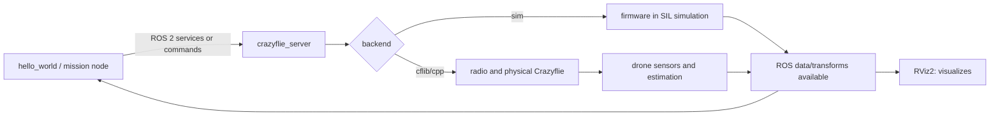

# Installation and validation status — WSL 2 + ROS 2 + Crazyswarm2

Companion document to the [main README](README.md). Its purpose is to let the team reproduce the starting point and tell what has been validated from what is still pending.

> **Summary:** an Ubuntu 22.04 installation on WSL 2 with ROS 2 Humble and Crazyswarm2 was validated. The `hello_world` example ran with the `sim` backend and could be visualized in RViz2 with `rviz:=True`. This document covers the base environment; the team's own navigation stack and its simulation results are described in the README. No link with a physical Crazyflie was tested from this setup.

## 1. Validated environment

| Item | Observed status |
|---|---|
| Windows + WSL 2 | Ubuntu 22.04 installed and running under WSL 2. |
| Linux user | `asus` on the development laptop. Other collaborators will have their own users. |
| Ubuntu storage | The distribution was moved to `E:\WSL\Ubuntu-22.04` to save space on C:. |
| ROS 2 | ROS 2 Humble Desktop installed on Ubuntu 22.04. |
| Crazyswarm2 | Binary `ros-humble-crazyflie*` packages installed from apt. |
| Firmware bindings | `cffirmware` became importable in Python and no longer blocked the simulated server. |
| Python dependency | `rowan` was installed for the simulated server. |
| RViz2 | Opened in WSLg when launched with `rviz:=True`. |
| GitHub | Remote repository `Comentario/mobile-robotics-hackathon-crazyflie`, local branch `main`; the user checked SSH authentication and that `origin` is listed. |

The Python installation was solved manually on the original laptop; there is no verified provisioning script yet to recreate everything from scratch on the collaborators' machines.

## 2. Starting the ROS 2 environment

Open Ubuntu 22.04 (WSL) and check ROS 2:

```bash
source /opt/ros/humble/setup.bash
echo "$ROS_DISTRO"
ros2 --help
```

`echo "$ROS_DISTRO"` is expected to print `humble`. When `source` runs in a new terminal, it only applies to that terminal. On the original laptop the environment was configured for the Ubuntu sessions; every collaborator must check their own installation.

Check that the Crazyflie packages are installed:

```bash
ros2 pkg list | grep '^crazyflie'
```

The original installation listed packages such as `crazyflie`, `crazyflie_description`, `crazyflie_examples`, `crazyflie_interfaces`, `crazyflie_py`, `crazyflie_server_cpp`, `crazyflie_server_py` and `crazyflie_sim`.

## 3. Simulation dependencies that were solved

### `cffirmware`

At first the server ended with `ModuleNotFoundError: No module named 'cffirmware'`. The Python bindings of the Crazyflie firmware were prepared and built in `~/crazyflie-firmware`; once that module was available, the server moved on to the next dependency. The `cffirmware` import was verified in the original environment.

Check for the original laptop:

```bash
python3 -c "import cffirmware; print('cffirmware ready')"
```

The firmware build path was `~/crazyflie-firmware/build`. If the import fails in a new terminal, check the Python environment and the real path before rebuilding:

```bash
export PYTHONPATH="$HOME/crazyflie-firmware/build${PYTHONPATH:+:$PYTHONPATH}"
python3 -c "import cffirmware; print('cffirmware ready')"
```

This path is specific to the installation made on the original laptop; do not assume it already exists on another computer.

### `rowan`

Next, `ModuleNotFoundError: No module named 'rowan'` appeared. Since `pip` was not installed, `python3-pip` was installed and then `rowan` for the Linux user.

```bash
python3 -m pip install --user rowan
python3 -c "import rowan; print('rowan ready')"
```

The repository does not store a virtual environment or a full list of Python dependencies yet; this is a manual installation confirmed in the original environment.

## 4. Simulation that did run

In Ubuntu, start:

```bash
ros2 launch crazyflie_examples launch.py script:=hello_world backend:=sim rviz:=True
```

Observed result:

- The launch started the `crazyflie_server`, `teleop`, `joy_node`, `hello_world` and RViz2.
- The server logged `takeoff(height=1.0 m, duration=2.5 s)` and later `land(...)` for `cf231`.
- `hello_world` finished cleanly.
- RViz2 showed the visualization when `rviz:=True` was used.

The `rviz:=True` option was required for this launch; without it the window did not appear. The `Stereo is NOT SUPPORTED` message did not prevent the visualization and is unrelated to audio. The output also reported OpenGL 4.2.

This test confirms that the example and the simulated backend start on that laptop. It does not show that the challenge perception works nor that a physical flight is ready.

## 5. ROS observation that was made

During the run, `ros2 node list` showed nodes such as:

```text
/crazyflie_server
/joy_node
/rviz2
/teleop
```

The observed topic list included:

```text
/cf231/cmd_full_state
/cf231/cmd_hover
/cf231/cmd_vel_legacy
/cf231/robot_description
/clock
/joy
/tf
/tf_static
```

Querying:

```bash
ros2 topic info /tf
ros2 topic info /cf231/cmd_full_state
```

returned:

```text
/tf: Publisher count 1, Subscription count 1
/cf231/cmd_full_state: Publisher count 0, Subscription count 1
```

The query was made after the `hello_world` sequence. A topic can exist even if nobody publishes data at that moment. The observed list **did not include** `/cf231/pose` or `/cf231/scan`, so a perception/localization flow for navigation was not validated with this example. To identify which nodes are the endpoints and to check services, use during an active run:

```bash
ros2 topic info /tf --verbose
ros2 topic list
ros2 service list
```

## 6. Mental model of the components



ROS 2 provides the communication between nodes. Crazyswarm2 defines the Crazyflie interface and server. The `sim` backend is an alternative to the physical link. RViz consumes data to display it; it neither decides the route nor controls the flight.

## 7. What is still missing

### So that every collaborator can reproduce the base

- [ ] Document the exact versions of WSL, Ubuntu, ROS 2, apt packages and firmware/bindings.
- [ ] Prepare clean installation instructions for another Linux user; do not depend on the personal `PYTHONPATH` of `asus`.
- [ ] Decide whether the repository is used from `/mnt/e/...` or whether the ROS source code gets a copy/clone inside the Linux filesystem (recommended for frequent `colcon` builds).

### For the challenge and the real hardware

- [ ] Confirm with the mentors which deck the assigned drone carries and which topics/sensors are available.
- [ ] Confirm whether Lighthouse and base stations, Optical Flow, Multi-ranger or a camera will be available and configured.
- [ ] Confirm the computer and backend to use (`cflib`/`cpp`) and access to the Crazyradio.
- [ ] Inspect hardware data: units, rate, frames, position quality and behaviour on invalid readings.
- [ ] Run supervised, repeatable physical tests in the authorized area.
- [ ] Record metrics and prepare the demo/presentation with known limits.

The mission node, obstacle avoidance and metrics now exist in the repository and pass in simulation; see the README.

## 8. Suggested next session

1. In an active Ubuntu terminal, launch the simulation again and open another terminal to list nodes/topics/services.
2. Build a table of the data required by the navigation node: position, distances, commands, units, rate and frame.
3. Take that table to the mentors to confirm what the real setup provides before tuning on hardware.

## References

- [Crazyswarm2 — installation](https://imrclab.github.io/crazyswarm2/installation.html)
- [Crazyswarm2 — usage and simulation](https://imrclab.github.io/crazyswarm2/usage.html)
- [Crazyswarm2 — overview of packages and backends](https://imrclab.github.io/crazyswarm2/overview.html)
- [Hackathon challenge and equipment](https://mobile-robotics.eu/)

---

## Detailed guide from scratch

This guide describes how to prepare a Windows computer with WSL 2, Ubuntu 22.04, ROS 2 Humble, Crazyswarm2, simulation and RViz2. It is meant for someone who has never installed ROS. The previous sections keep the status and the results observed on the original laptop.

### Before starting: which terminal to use

There are two different terminals. Do not mix their commands:

- **Windows PowerShell:** commands such as wsl and New-Item. Open it from Start by searching for PowerShell. To install WSL for the first time, open it as administrator.
- **Ubuntu (WSL):** Linux terminal; the commands use sudo, apt, cd, source, make and ros2. The Linux password shows no characters while typing: this is normal.

The Linux user name must start with a lowercase letter. On the original laptop, ASUS was rejected; asus worked. The Ubuntu user and password are local to that distribution and do not have to match Windows.

### 1. Install or check WSL 2 and Ubuntu 22.04

In PowerShell as administrator:

    wsl --install
    wsl --update
    wsl --set-default-version 2
    wsl --install -d Ubuntu-22.04

If Windows asks for a restart, restart. Open Ubuntu from the Start menu and create the Linux user.

Check from PowerShell:

    wsl --status
    wsl --version
    wsl --list --verbose

In the list, Ubuntu-22.04 must show VERSION 2. If it shows VERSION 1:

    wsl --set-version Ubuntu-22.04 2

Then check from Ubuntu:

    whoami
    lsb_release -a
    uname -m

Ubuntu 22.04 (Jammy) and an x86_64/amd64 architecture are expected on a typical Intel/AMD laptop.

Microsoft references: [install WSL](https://learn.microsoft.com/windows/wsl/install) · [WSL commands](https://learn.microsoft.com/windows/wsl/basic-commands)

### 2. Optional: move Ubuntu to another disk before installing ROS

Ubuntu lives inside a virtual disk that normally takes space on C:. If C: is short of space and another disk is available (E: in our case), move the distribution before installing large packages.

In PowerShell, create the parent directory:

    New-Item -ItemType Directory -Path E:\WSL -Force

Close every Ubuntu window and application that may keep WSL busy (for example VS Code connected to WSL or Docker Desktop). Then:

    wsl --shutdown
    wsl --list --verbose
    wsl --manage Ubuntu-22.04 --move E:\WSL\Ubuntu-22.04

The --manage ... --move option requires a recent WSL version. If PowerShell reports that --manage does not exist, run wsl --update, close and reopen PowerShell, and check wsl --help.

**Error we hit:** ERROR_SHARING_VIOLATION / "the file is being used by another process". It does not mean that Ubuntu was lost; an instance is still using its disk. Close Ubuntu and WSL applications, run wsl --shutdown, check with wsl --list --verbose that the distro is stopped and retry. If it persists, restart Windows before retrying. Do not run wsl --unregister: it is destructive and deletes the distribution.

After the move, open Ubuntu and confirm that it starts. The step is optional if there is enough space on C:.

### 3. Update Ubuntu and install the base tools

In Ubuntu:

    sudo apt update
    sudo apt upgrade -y
    sudo apt install -y curl gnupg lsb-release software-properties-common build-essential git python3-pip python3-venv python3-dev swig python3-colcon-common-extensions python3-rosdep python3-vcstool python3-argcomplete

If apt upgrade asks whether to continue, answer Y and Enter. apt update refreshes the package index; apt upgrade updates the packages already installed.

Check that the locale uses UTF-8:

    locale

If a warning about a missing or non-UTF-8 locale appears:

    sudo apt install -y locales
    sudo locale-gen en_US en_US.UTF-8
    sudo update-locale LC_ALL=en_US.UTF-8 LANG=en_US.UTF-8
    export LANG=en_US.UTF-8
    locale

### 4. Install ROS 2 Humble Desktop

Humble is paired with Ubuntu 22.04. The Desktop option includes graphical tools such as RViz2. Run in Ubuntu:

    sudo add-apt-repository universe
    sudo apt update
    sudo curl -sSL https://raw.githubusercontent.com/ros/rosdistro/master/ros.key -o /usr/share/keyrings/ros-archive-keyring.gpg
    echo "deb [arch=$(dpkg --print-architecture) signed-by=/usr/share/keyrings/ros-archive-keyring.gpg] http://packages.ros.org/ros2/ubuntu $(. /etc/os-release && echo $UBUNTU_CODENAME) main" | sudo tee /etc/apt/sources.list.d/ros2.list > /dev/null
    sudo apt update

Before installing, check that apt finds the package:

    apt-cache policy ros-humble-desktop

It must show a Candidate other than (none). Install:

    sudo apt install -y ros-humble-desktop
    sudo apt install -y python3-colcon-common-extensions python3-rosdep python3-vcstool

Activate ROS in the current terminal:

    source /opt/ros/humble/setup.bash
    echo $ROS_DISTRO
    ros2 --help

humble and the ros2 help are expected.

To load ROS automatically in new terminals, add the line once:

    grep -qxF 'source /opt/ros/humble/setup.bash' ~/.bashrc || echo 'source /opt/ros/humble/setup.bash' >> ~/.bashrc
    source ~/.bashrc

Initialize rosdep, the tool that installs the dependencies declared by ROS packages. If it was already initialized, do not repeat it:

    if [ ! -e /etc/ros/rosdep/sources.list.d/20-default.list ]; then sudo rosdep init; fi
    rosdep update

**Possible problem:** Unable to locate package ros-humble-desktop. Check that lsb_release -cs returns jammy, that /etc/apt/sources.list.d/ros2.list exists and points to packages.ros.org/ros2/ubuntu, and that sudo apt update did not end with an error. Then repeat apt-cache policy ros-humble-desktop.

Reference: [ROS 2 Humble binary installation](https://docs.ros.org/en/humble/Installation/Ubuntu-Install-Debians.html)

### 5. Check ROS 2 between two terminals

Open two Ubuntu terminals. In both:

    source /opt/ros/humble/setup.bash

In the first one:

    ros2 run demo_nodes_cpp talker

Leave it open. In the second one:

    ros2 run demo_nodes_py listener

The listener must print messages received from the talker. Stop each process with Ctrl+C. This tests basic ROS 2, not Crazyswarm2. If ros2 is not found, run source /opt/ros/humble/setup.bash in that terminal.

### 6. Install Crazyswarm2 and rowan

In Ubuntu:

    sudo apt update
    apt-cache policy ros-humble-crazyflie
    sudo apt install -y 'ros-humble-crazyflie*'

Then check:

    source /opt/ros/humble/setup.bash
    ros2 pkg list | grep '^crazyflie'

Packages such as crazyflie, crazyflie_examples, crazyflie_interfaces and crazyflie_sim must appear.

Check the rowan Python module:

    python3 -c "import rowan; print('rowan ready')"

If ModuleNotFoundError: No module named 'rowan' appears:

    sudo apt update
    sudo apt install -y python3-pip
    python3 -m pip install --user rowan
    python3 -c "import rowan; print('rowan ready')"

**Problem we hit:** the pip command did not exist. Ubuntu may lack the pip executable; python3 -m pip explicitly selects the Python version. If pip is missing, install python3-pip with apt. Do not use sudo pip.

### 7. Prepare cffirmware for the simulated backend (SIL)

This step is only needed if the sim backend ends with ModuleNotFoundError: No module named 'cffirmware'. The simulator uses Python bindings of parts of the Crazyflie firmware.

Install the tools:

    sudo apt update
    sudo apt install -y git make gcc-arm-none-eabi build-essential python3-dev python3-setuptools python3-numpy swig

Clone the firmware. If ~/crazyflie-firmware already exists, do not clone it again: enter that folder and check the branch.

    cd ~
    git clone --branch 2025.02 --single-branch --recursive https://github.com/bitcraze/crazyflie-firmware.git
    cd ~/crazyflie-firmware
    git status --short --branch

If it was already cloned but the submodules were missing:

    cd ~/crazyflie-firmware
    git submodule update --init --recursive

Configure, generate the headers and build:

    make cf2_defconfig
    make -j2
    make bindings_python

make -j2 builds the firmware and may take a while. **It does not flash the drone.** Do not run make flash, make cload or any other flashing target to prepare the simulation. The Bitcraze guide documents make cf2_defconfig and make bindings_python; on the original laptop the header generation had to be completed before building the bindings again.

If make bindings_python ends correctly, install the bindings for the user:

    cd ~/crazyflie-firmware/build
    python3 setup.py install --user

Test the import from the build folder:

    PYTHONPATH="$HOME/crazyflie-firmware/build:$PYTHONPATH" python3 -c "import cffirmware; print('cffirmware ready')"

To keep PYTHONPATH in new terminals, add it once:

    grep -qxF 'export PYTHONPATH="$HOME/crazyflie-firmware/build:$PYTHONPATH"' ~/.bashrc || echo 'export PYTHONPATH="$HOME/crazyflie-firmware/build:$PYTHONPATH"' >> ~/.bashrc
    source ~/.bashrc
    python3 -c "import cffirmware; print('cffirmware ready')"

**Error we hit: autoconf.h: No such file or directory.** make cf2_defconfig created .config, but in that run build/include/generated/autoconf.h did not exist yet. Complete the process that generates the headers before repeating the bindings:

    cd ~/crazyflie-firmware
    make -j2
    ls build/include/generated/autoconf.h
    make bindings_python

If ls still says that it does not exist, check the first error of make -j2, the installed tools and that you are at the root of ~/crazyflie-firmware. Do not create autoconf.h manually.

**Later error: No module named '_cffirmware'.** cffirmware.py may exist without the native extension _cffirmware. Check that make bindings_python ended without error, check the build files and try again with PYTHONPATH. It is not enough that make cf2_defconfig created .config.

References: [Crazyswarm2 installation and SIL](https://imrclab.github.io/crazyswarm2/installation.html) · [firmware and bindings build](https://github.com/bitcraze/crazyflie-firmware/blob/master/docs/building-and-flashing/build.md)

### 8. Launch the simulation and RViz2

In Ubuntu:

    ros2 launch crazyflie_examples launch.py script:=hello_world backend:=sim rviz:=True

On the original laptop, the server logged the takeoff and landing of cf231, hello_world finished cleanly and RViz2 opened. Keep the terminal open while watching the simulation.

rviz:=True matters: in the tested installation, RViz was not launched when that argument was omitted. The Stereo is NOT SUPPORTED warning did not prevent the visualization and is unrelated to audio; the output also reported OpenGL 4.2.

If RViz does not open:

1. From PowerShell: wsl --update
2. Close Ubuntu and run in PowerShell: wsl --shutdown
3. Open Ubuntu again and try: rviz2
4. Check wsl --list --verbose (it must say version 2) and in Ubuntu: echo $DISPLAY and echo $WAYLAND_DISPLAY

Graphics compatibility depends on Windows/WSL and the drivers. Reference: [Microsoft: Linux GUI apps on WSL](https://learn.microsoft.com/windows/wsl/tutorials/gui-apps).

### 9. Inspect ROS with the launch running

Do not close the launch terminal. Open another Ubuntu terminal:

    source /opt/ros/humble/setup.bash
    ros2 node list
    ros2 topic list
    ros2 topic info /tf --verbose
    ros2 service list

A topic can appear even if it publishes no messages at that moment. In our inspection, /cf231/cmd_full_state had one subscriber and zero publishers after hello_world ended; we did not see /cf231/pose or /scan in that test.

**Limit:** this test verifies the launch, high-level commands and the available visualization; it does not test perception, mapping, autonomous localization or obstacle avoidance. Availability depends on the backend and the configuration; confirm with the mentors which topics the event hardware provides.

### 10. What this installation does not cover

- Crazyradio USB access from WSL is not covered here. The Crazyswarm2 documentation rates WSL as experimental and mentions usbipd-win to attach USB devices (drone 2 used it, see [docs/cf2_flow_multiranger.md](docs/cf2_flow_multiranger.md)).
- No physical Crazyflie, radio link or real flight is tested by this guide.
- It does not confirm which decks, camera or topics will be available for the challenge.
- Do not present the RViz result of this example as a full validation of perception or planning.

Confirm whether an event NUC/Jetson will be used instead of the laptop/WSL. Reference: [Crazyswarm2 WSL notes](https://imrclab.github.io/crazyswarm2/installation.html).

### 11. Checklist per collaborator

- [ ] wsl --list --verbose shows Ubuntu-22.04 as version 2.
- [ ] Ubuntu shows Jammy/22.04 and the Linux user is valid.
- [ ] echo $ROS_DISTRO shows humble.
- [ ] talker/listener communicate in two terminals.
- [ ] ros2 pkg list | grep '^crazyflie' finds the packages.
- [ ] python3 -c "import rowan" ends without error.
- [ ] If the sim backend will be used: python3 -c "import cffirmware" ends without error.
- [ ] The hello_world launch with the sim backend and rviz:=True opens RViz and logs takeoff/land.
- [ ] Everybody understands that USB/radio and real sensors must be checked on the event hardware.

When uploading this guide, do not include the Ubuntu VHDX, SSH keys, tokens or private data. The VHDX contains the whole installation and is far too large for Git; every member prepares their own WSL.
