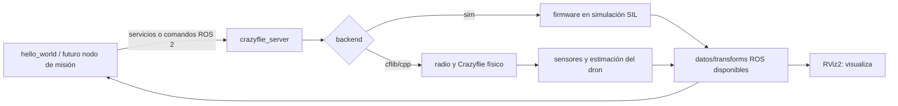

# Estado de instalación y validación — WSL 2 + ROS 2 + Crazyswarm2

Documento complementario al [README principal](README.md). Su propósito es que el equipo pueda reproducir el punto de partida y distinguir lo validado de lo pendiente.

> **Resumen:** se validó una instalación de Ubuntu 22.04 sobre WSL 2 con ROS 2 Humble y Crazyswarm2. El ejemplo `hello_world` funcionó con el backend `sim` y pudo visualizarse en RViz2 al activar `rviz:=True`. **Aún no** se implementó navegación autónoma propia ni se probó el enlace con un Crazyflie físico.

## 1. Entorno validado

| Elemento | Estado observado |
|---|---|
| Windows + WSL 2 | Ubuntu 22.04 instalado y ejecutándose bajo WSL 2. |
| Usuario Linux | `asus` en la laptop de desarrollo. Otros colaboradores tendrán sus propios usuarios. |
| Almacenamiento de Ubuntu | La distribución se movió a `E:\WSL\Ubuntu-22.04` para conservar espacio en C:. |
| ROS 2 | ROS 2 Humble Desktop instalado en Ubuntu 22.04. |
| Crazyswarm2 | Paquetes binarios `ros-humble-crazyflie*` instalados desde apt. |
| Bindings firmware | `cffirmware` se hizo importable en Python y dejó de bloquear el servidor simulado. |
| Dependencia Python | `rowan` se instaló para el servidor simulado. |
| RViz2 | Abrió en WSLg al lanzar con `rviz:=True`. |
| GitHub | Repositorio remoto `Comentario/mobile-robotics-hackathon-crazyflie`, rama local `main`; el usuario comprobó autenticación SSH y que `origin` aparece. |

La instalación de Python fue resuelta manualmente en la laptop original; no hay todavía un script de provisión verificado para recrear todo desde cero en los equipos de los colaboradores.

## 2. Arranque del entorno ROS 2

Abrir Ubuntu 22.04 (WSL) y comprobar ROS 2:

```bash
source /opt/ros/humble/setup.bash
echo "$ROS_DISTRO"
ros2 --help
```

Se espera que `echo "$ROS_DISTRO"` muestre `humble`. Si `source` se ejecuta en una terminal nueva, aplica solo a esa terminal. En la laptop original se configuró el entorno para las sesiones Ubuntu; cada colaborador debe verificar su propia instalación.

Comprobar que los paquetes Crazyflie están instalados:

```bash
ros2 pkg list | grep '^crazyflie'
```

La instalación original mostró paquetes como `crazyflie`, `crazyflie_description`, `crazyflie_examples`, `crazyflie_interfaces`, `crazyflie_py`, `crazyflie_server_cpp`, `crazyflie_server_py` y `crazyflie_sim`.

## 3. Dependencias de la simulación que se resolvieron

### `cffirmware`

Al inicio, el servidor terminó con `ModuleNotFoundError: No module named 'cffirmware'`. Se prepararon y compilaron los bindings Python del firmware Crazyflie en `~/crazyflie-firmware`; tras resolver ese módulo, el servidor pudo avanzar a la siguiente dependencia. En el entorno original se llegó a verificar la importación de `cffirmware`.

Comprobación para la laptop original:

```bash
python3 -c "import cffirmware; print('cffirmware listo')"
```

La ruta de construcción del firmware estaba en `~/crazyflie-firmware/build`. Si el import falla en una terminal nueva, revisar el entorno Python y la ruta real antes de recompilar:

```bash
export PYTHONPATH="$HOME/crazyflie-firmware/build${PYTHONPATH:+:$PYTHONPATH}"
python3 -c "import cffirmware; print('cffirmware listo')"
```

Esta ruta es específica de la instalación que se hizo en la laptop original; no asumir que ya existe en otro computador.

### `rowan`

Después apareció `ModuleNotFoundError: No module named 'rowan'`. Como `pip` no estaba instalado, se instaló `python3-pip` y luego `rowan` para el usuario Linux.

```bash
python3 -m pip install --user rowan
python3 -c "import rowan; print('rowan listo')"
```

No se guarda un entorno virtual ni una lista completa de dependencias Python en el repositorio todavía; esta es una instalación manual confirmada en el entorno original.

## 4. Simulación que sí se ejecutó

En Ubuntu, iniciar:

```bash
ros2 launch crazyflie_examples launch.py script:=hello_world backend:=sim rviz:=True
```

Resultado observado:

- El launch inició el servidor `crazyflie_server`, `teleop`, `joy_node`, `hello_world` y RViz2.
- El servidor registró `takeoff(height=1.0 m, duration=2.5 s)` y, posteriormente, `land(...)` para `cf231`.
- `hello_world` terminó limpiamente.
- RViz2 mostró la visualización cuando se usó `rviz:=True`.

La opción `rviz:=True` fue necesaria en este lanzamiento; sin ella no apareció la ventana. El mensaje `Stereo is NOT SUPPORTED` no impidió visualizar y no se relacionó con audio. La salida también mostró OpenGL 4.2.

Esta prueba confirma que el ejemplo y el backend simulado arrancan en esa laptop. No demuestra que la percepción del reto funcione ni que el vuelo físico esté preparado.

## 5. Observación ROS que se realizó

Durante la ejecución, `ros2 node list` mostró nodos como:

```text
/crazyflie_server
/joy_node
/rviz2
/teleop
```

La lista de topics observada incluyó:

```text
/cf231/cmd_full_state
/cf231/cmd_hover
/cf231/cmd_vel_legacy
/cf231/robot_description
/clock
/joy
/tf
/tf_static
```

Al consultar:

```bash
ros2 topic info /tf
ros2 topic info /cf231/cmd_full_state
```

se obtuvo:

```text
/tf: Publisher count 1, Subscription count 1
/cf231/cmd_full_state: Publisher count 0, Subscription count 1
```

La consulta se hizo tras la secuencia de `hello_world`. Un topic puede existir aunque en ese instante nadie publique datos. La lista observada **no incluyó** `/cf231/pose` ni `/cf231/scan`; por ello no se ha validado todavía un flujo de percepción/localización para navegación. Para identificar qué nodos son los endpoints y revisar servicios, usar durante una ejecución activa:

```bash
ros2 topic info /tf --verbose
ros2 topic list
ros2 service list
```

## 6. Modelo mental de los componentes



ROS 2 proporciona la comunicación entre nodos. Crazyswarm2 define la interfaz y el servidor del Crazyflie. El backend `sim` es una alternativa al enlace físico. RViz consume datos para mostrarlos; no decide la ruta ni hace el control de vuelo.

## 7. Lo que todavía falta

### Para que cada colaborador pueda reproducir la base

- [ ] Documentar versiones exactas de WSL, Ubuntu, ROS 2, paquetes apt y firmware/bindings.
- [ ] Preparar instrucciones limpias de instalación para otro usuario Linux; no depender del `PYTHONPATH` personal de `asus`.
- [ ] Decidir si el repositorio se usará desde `/mnt/e/...` o si el código fuente ROS tendrá una copia/clon dentro del filesystem Linux (recomendable para builds frecuentes con `colcon`).
- [ ] Verificar el README y este documento en GitHub después del primer commit/push.

### Para el reto y el hardware real

- [ ] Confirmar con mentores qué deck lleva el dron asignado y qué topics/sensores están disponibles.
- [ ] Confirmar si Lighthouse y estaciones base, Optical Flow, Multi-Ranger o cámara estarán disponibles y configurados.
- [ ] Confirmar el ordenador y backend que se usarán (`cflib`/`cpp`) y el acceso al Crazyradio; WSL USB no ha sido probado.
- [ ] Inspeccionar datos en hardware: unidades, frecuencia, frames, calidad de posición y comportamiento ante lecturas inválidas.
- [ ] Implementar el nodo de misión: waypoints, máquina de estados, timeout y aterrizaje seguro.
- [ ] Implementar y probar evitación de obstáculos acorde al sensor real.
- [ ] Hacer pruebas físicas supervisadas, repetibles y en el área autorizada.
- [ ] Registrar métricas y preparar demo/presentación con límites conocidos.

## 8. Siguiente sesión sugerida

1. Revisar que el README principal y este archivo estén en GitHub.
2. En una terminal Ubuntu activa, volver a lanzar la simulación y abrir otra terminal para listar nodos/topics/servicios.
3. Crear una tabla de datos requeridos por el nodo de navegación: posición, distancias, comandos, unidades, frecuencia y frame.
4. Llevar esa tabla a los mentores para confirmar qué proporciona el setup real antes de escoger algoritmo.

## Referencias

- [Crazyswarm2 — instalación](https://imrclab.github.io/crazyswarm2/installation.html)
- [Crazyswarm2 — uso y simulación](https://imrclab.github.io/crazyswarm2/usage.html)
- [Crazyswarm2 — overview de paquetes y backends](https://imrclab.github.io/crazyswarm2/overview.html)
- [Reto y equipamiento de la hackaton](https://mobile-robotics.eu/)
