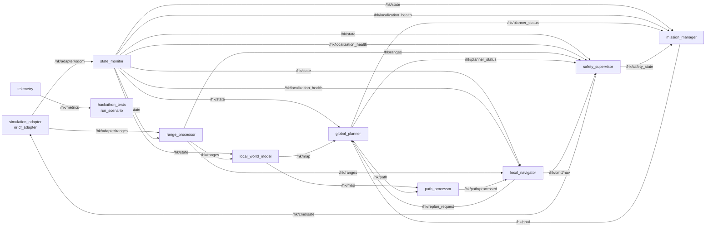

# Stack interfaces (TP-06, TP-09)

Contract between packages. If you change a topic, a message or a service, update this document **in the same PR**.

The sections from [ROS 2 concepts](#ros-2-concepts) to [Sensors: what reaches the stack](#sensors-what-reaches-the-stack) are a guide to how the stack is organized. The contract itself starts at [Rules](#rules).

## ROS 2 concepts

| Concept | What it is | Analogy |
|---|---|---|
| **Package** | Folder inside `ros2_ws/src/` with its code, `package.xml` and `setup.py`. It is the unit that `colcon` builds. | A module or library |
| **Node** | A running program. Every package of this stack has one (`*_node.py`). | A process or microservice |
| **Topic** | Named channel (`/hk/state`) on which a node **publishes** data continuously and others **subscribe**. | A radio station |
| **Message** | Format of the data of a topic: standard ROS (`nav_msgs/Odometry`) or our own (`hackathon_interfaces/MultiRange`). | The schema of a JSON |
| **Service** | One-off request with a response, e.g. "take off to 0.5 m" → "ok". | An API call |
| **Frame (TF)** | Named coordinate system (`map`, `base_link`…). ROS converts positions between them. | "In front of the drone" versus "north of the map" |
| **Launch file** | Script that starts several nodes at once with their configuration. | A `docker-compose` |
| **Workspace** | `ros2_ws/`: groups all the packages; `colcon build` builds them together. | A monorepo |

## Data flow

A full cycle goes from the drone (or the simulator) to the command sent back to the drone:

1. **Sense:** the adapter publishes the estimated pose (`/hk/adapter/odom`) and the ranges (`/hk/adapter/ranges`).
2. **Normalize:** `state_monitor` publishes the single state (`/hk/state`) and the localization health. `range_processor` publishes the filtered ranges (`/hk/ranges`).
3. **Model the environment:** `local_world_model` turns the ranges into a local map (`/hk/map`).
4. **Decide the goal:** `mission_manager` publishes the current waypoint (`/hk/goal`).
5. **Plan:** `global_planner` computes the route (`/hk/path`) and `path_processor` simplifies it (`/hk/path/processed`).
6. **Propose a command:** `local_navigator` follows the route, avoids whatever appears and proposes a setpoint (`/hk/cmd/nav`).
7. **Validate:** `safety_supervisor` accepts, reduces or overrides the command and publishes the final one (`/hk/cmd/safe`).
8. **Act:** the adapter sends the setpoint to the Crazyflie (or integrates it in the simulator). Attitude and motor control stay onboard.

The full diagram is in [Node graph](#node-graph). In cooperative-route mode (CF1), steps 3 and 5 are replaced by an offline route planned on the CF2 map and served by `scripts/cooperative_route.py`.

Two design ideas:

- **Only the adapter changes between simulation and hardware.** The rest of the stack does not know whether a real drone or the simulator is flying, so everything can be developed without hardware.
- **The navigator proposes and the supervisor decides.** The drone only listens to `/hk/cmd/safe`, which only `safety_supervisor` publishes. A navigation failure never reaches the drone without passing the safety filter.

## What every package does

| Module | Package | What it does | Question it answers | TPs |
|---|---|---|---|---|
| 1 | `simulation_adapter` | **Simulated drone**: publishes pose and synthetic ranges (raycast against YAML obstacles) and integrates the received setpoints. Scenario fault injection available. | Where am I and what do I see? (simulation) | TP-10 |
| 1 | `cf_adapter` | **Real drone**: translates between Crazyswarm2 and the `/hk/*` API. It is the only package that knows Crazyswarm2. | Where am I and what do I see? (hardware) | TP-08, TP-09 |
| 2 | `state_monitor` | Publishes the single state (`map → base_link`) and the localization health: `GOOD` / `DEGRADED` / `LOST`. It is not a new EKF. | Can I trust my position? | TP-13 to TP-17 |
| 3 | `range_processor` | Validates and filters the ranges (NaN, out of range, spikes), estimates closing rates and turns them into rays with a direction. | Which obstacles do I detect now? | TP-19 to TP-22 |
| 4 | `local_world_model` | 2D grid around the drone (free/occupied/unknown) with inflation and expiry of old obstacles. | What does the nearby environment look like? | TP-23 to TP-25 |
| 0 | `mission_manager` | Reads the waypoints from the YAML and runs the mission state machine (take off, navigate, land, abort). | Where do I have to go now? | TP-26 to TP-28 |
| 5 | `global_planner` | A* over the local map, with replanning, timeout and failure state. | Which way do I go? | TP-29 to TP-31 |
| 6 | `path_processor` | Simplifies the route (line-of-sight shortcut), generates the lookahead and limits the speed. | How do I smooth the route? | TP-32, TP-33 |
| 7 | `local_navigator` | Follows the route, applies reactive avoidance and requests a replan when needed. | What do I do right now? | TP-34 to TP-36 |
| 8 | `safety_supervisor` | Overrides normal navigation (`SLOW`, `HOVER`, `LAND`, `ABORT`) because of a close obstacle, an old pose, sensor loss, geofence, height or a planner without a route. | Is it safe to do this? | TP-37 to TP-40 |
| 9 | `telemetry` | Run metrics: collisions and clearance against the simulator ground truth, states seen, mission time. | How did it go? | TP-40, TP-41 |
| 9 | `hackathon_tests` | Runs the T01–T16 scenarios (wall, corridor, popping obstacle, localization loss…) and evaluates the result. | Does the stack hold up? | TP-41 |
| – | `hackathon_bringup` | No node of its own: launch files and YAML configuration (worlds, missions, scenarios, frames). | How do I start everything? | TP-12 |
| – | `hackathon_interfaces` | No node: defines our own messages and services. | What format does the data have? | TP-06 |

The "Module" column is the architecture numbering of the [roadmap](roadmap.md#modules-and-packages).

## Package structure

All Python packages follow the same pattern (example: `state_monitor`):

```text
state_monitor/
├── package.xml                 # name and dependencies (read by colcon)
├── setup.py / setup.cfg        # package installation and executables
├── resource/state_monitor      # empty marker ROS uses to find the package
├── state_monitor/
│   ├── state_monitor_node.py   # ROS wrapper: parameters, publishers, subscribers, timers
│   └── health.py               # pure logic, no rclpy
└── test/
    └── test_health.py          # pytest tests of the pure logic
```

Logic is kept apart from the node (rule 6) so it can be tested with `pytest` in milliseconds, without launching ROS. The node only connects that logic to the topics.

**Current status:** every package is implemented and tested. `cf_adapter` implements TP-09 with conversion, ROS-communication and SIL-connection tests. `simulation_adapter` implements TP-10 with fault injection. `state_monitor`, `range_processor` (including the `/hk/ranges/markers` rays), `local_world_model`, `mission_manager`, `global_planner` (A*), `path_processor`, `local_navigator` and `safety_supervisor` are complete, and `telemetry` + `hackathon_tests` evaluate the T01–T16 matrix automatically. The reference numbering is in the roadmap.

## Sensors: what reaches the stack

| Sensor | Where it appears | Notes |
|---|---|---|
| Lighthouse | Indirectly in `/hk/adapter/odom` | The onboard EKF fuses it into the pose. |
| Flow Deck: optical flow sensor (PMW3901) | Indirectly in `/hk/adapter/odom` (mostly in the velocity) | It is a very low resolution camera, but the firmware only exposes the measured displacement (`motion.deltaX`, `motion.deltaY`), not the image. There is no image topic. |
| Flow Deck: bottom ToF (VL53L1x) | `MultiRange.down` | Height above the floor. The EKF also uses it. |
| Multi-ranger | `MultiRange.front/back/left/right/up` | Five rays; see REP-117 in the message. |
| IMU | Indirectly in `/hk/adapter/odom` | Only the onboard EKF and controller use it. |

If the raw optical flow were needed (e.g. to diagnose surfaces without texture), `cf_adapter` can request it from Crazyswarm2 as log variables (`motion.deltaX`, `motion.deltaY`, `motion.squal`). Today it is not part of the API.

## Rules

1. **Only `cf_adapter` knows Crazyswarm2.** The mission, navigation and safety nodes do not use `/cfXXX/...` topics or services (TP-09). The simulators and `sim_sensors` produce/emulate the external API.
2. **`simulation_adapter` and `cf_adapter` must expose the same API** (`/hk/adapter/*`, `/hk/takeoff`, `/hk/land`, `/hk/emergency`). Both adapters implement those endpoints; the physical and backend limitations are documented below. Moving from simulation to hardware means changing the adapter (VS-5).
3. **Only `safety_supervisor` publishes `/hk/cmd/safe`**, which is the only thing the adapters listen to. `local_navigator` only *proposes* commands on `/hk/cmd/nav`.
4. The whole stack consumes **a single state**: `/hk/state` (TP-14).
5. SI units (m, s, rad), REP-103 axes (x forward, y left, z up) and ranges according to REP-117 (`+inf` no return, `-inf` too close, `NaN` invalid).
6. Logic goes in **pure Python** modules (no `rclpy`) inside every package, and `*_node.py` is only a ROS wrapper. That way the logic is tested with pytest without launching ROS.
7. **Parameters:** `snake_case` names, in SI units (`state_timeout` in s, `z_max` in m). The values live in `hackathon_bringup/config/*.yaml`, not in the code: the `/**` section holds the shared ones (`map_frame`, `base_frame`, `z_min`…) and every node has its own section with its name. The node declares every parameter with a default value and lists it in the header of its `*_node.py`.

## Node graph



## Topics

| Topic | Type | Publisher | Subscribers |
|---|---|---|---|
| `/hk/adapter/odom` | `nav_msgs/Odometry` | adapter | state_monitor |
| `/hk/adapter/ranges` | `hackathon_interfaces/MultiRange` | adapter | range_processor |
| `/hk/state` | `nav_msgs/Odometry` | state_monitor | almost everyone |
| `/hk/localization_health` | `hackathon_interfaces/LocalizationHealth` | state_monitor | mission_manager, local_navigator, safety_supervisor, telemetry |
| `/hk/ranges` | `hackathon_interfaces/MultiRange` | range_processor | local_world_model, local_navigator, safety_supervisor |
| `/hk/ranges/closing_rate` | `hackathon_interfaces/MultiRange` | range_processor | local_navigator, safety_supervisor |
| `/hk/ranges/markers` | `visualization_msgs/MarkerArray` | range_processor | RViz |
| `/hk/map` | `nav_msgs/OccupancyGrid` | local_world_model | global_planner, path_processor, RViz |
| `/hk/goal` | `geometry_msgs/PoseStamped` | mission_manager | global_planner, RViz |
| `/hk/mission_status` | `hackathon_interfaces/MissionStatus` | mission_manager | telemetry, run_scenario |
| `/hk/path` | `nav_msgs/Path` | global_planner | path_processor, RViz |
| `/hk/planner_status` | `hackathon_interfaces/PlannerStatus` | global_planner | mission_manager, safety_supervisor, telemetry |
| `/hk/path/processed` | `nav_msgs/Path` | path_processor (or `cooperative_route.py`) | local_navigator, RViz |
| `/hk/replan_request` | `std_msgs/String` (reason) | local_navigator | global_planner |
| `/hk/cmd/nav` | `hackathon_interfaces/Setpoint` | local_navigator | safety_supervisor |
| `/hk/cmd/safe` | `hackathon_interfaces/Setpoint` | safety_supervisor | adapter |
| `/hk/safety_state` | `hackathon_interfaces/SafetyState` | safety_supervisor | mission_manager, telemetry |
| `/hk/metrics` | `std_msgs/String` (JSON) | telemetry | run_scenario |
| `/hk/sim/ground_truth` | `nav_msgs/Odometry` | simulation_adapter | telemetry (simulation only) |
| `/hk/sim/obstacles` | `visualization_msgs/MarkerArray` | simulation_adapter | telemetry, RViz (simulation only) |

## Services

| Service | Type | Server | Clients |
|---|---|---|---|
| `/hk/takeoff` | `hackathon_interfaces/Takeoff` | adapter | mission_manager |
| `/hk/land` | `hackathon_interfaces/Land` | adapter | mission_manager, safety_supervisor |
| `/hk/emergency` | `std_srvs/Trigger` | adapter | safety_supervisor, operator |
| `/hk/mission/start`, `pause`, `resume`, `abort` | `std_srvs/Trigger` | mission_manager | operator |

In our own simulator, `success=true` confirms acceptance, not arrival. The `KinematicDrone`
model separates GROUND, TAKING_OFF, FLYING, LANDING and EMERGENCY. Only FLYING accepts
navigation references; to leave GROUND a takeoff must be requested. Takeoff/landing
generate a smooth vertical reference over the requested duration and wait for position/
velocity within `position_tolerance` and `settle_speed`; the model limits can extend the
arrival. Landing takes priority over navigation and can interrupt a takeoff. On ground
contact Z=0 and zero velocity are set. Emergency interrupts any manoeuvre and simulates a
fall under `gravity`, without motor control or drag, until ground contact; it stays latched
until the node is restarted. It reproduces neither the emergency firmware nor 6DOF
dynamics. In free flight, losing commands captures HOVER; that watchdog does not cancel the
service manoeuvres, which do not require a setpoint stream.

## Our own messages (`hackathon_interfaces`)

| Message | Content |
|---|---|
| `MultiRange` | `front`, `back`, `left`, `right`, `up`, `down` (Flow Deck ToF), `range_min`, `range_max`; REP-117. |
| `Setpoint` | `mode` (POSITION / VELOCITY / HOVER), `position`, `velocity`, `yaw`; `map` frame. |
| `LocalizationHealth` | `status` (GOOD / DEGRADED / LOST), `pose_age`, `reason`. |
| `SafetyState` | `state` (NORMAL / SLOW / HOVER / LAND / ABORT), `speed_scale`, `reason`. |
| `MissionStatus` | `state` (IDLE … ABORTED), `waypoint_index`, `waypoint_count`, `reason`. |
| `PlannerStatus` | `status` (IDLE / OK / NO_PATH / TIMEOUT / NO_MAP), `replan_count`, `plan_time`, `reason`. |
| `Takeoff.srv`, `Land.srv` | Height and duration → `success`, `message`. |

## Frames (TF)

```text
map ──(state_monitor)──> base_link ──(static, config/frames.yaml)──> front_range
                                                                  ├─> back_range
                                                                  ├─> left_range
                                                                  ├─> right_range
                                                                  ├─> up_range
                                                                  └─> down_tof
```

Crazyswarm2 publishes its own TF (`world -> cfXXX`). In SIL, `cf_adapter` can read it to publish `/hk/adapter/odom`; on hardware it can consume odometry or pose. The rest of the stack consumes `/hk/state`, and `state_monitor` publishes `map -> base_link`. The frame called `odom` is not used for now; the `nav_msgs/Odometry` message is.

## Crazyswarm2 adapter — TP-09

TP-08 and the SIL limitations are documented in [crazyflie_command_interface.md](crazyflie_command_interface.md). Only `cf_adapter` knows the robot endpoints; their names can change through parameters without modifying the colleagues' packages.

| Parameter | Use / default value |
|---|---|
| `robot_name`, `group_mask` | Robot `cf231`, group `0` |
| `map_frame`, `base_frame`, `source_frame` | `map`, `base_link`, `world` |
| `state_source` | `odom` (default), `pose` or `tf` |
| `odom_topic`, `pose_topic`, `scan_topic` | Empty uses `/<robot>/odom`, `/<robot>/pose`, `/<robot>/scan` |
| `odom_linear_frame`, `odom_angular_units` | Input convention: `body`/`world`, `radians`/`degrees`. By default, standard ROS: `body`, `radians` |
| `vertical_ranges_topic` | Empty disables vertical data. If set, it receives `LogDataGeneric` with **exactly** `[range.up, range.zrange]` in mm |
| `flow_only`, `flow_range_min`, `flow_range_max` | Lighthouse + Flow without Multi-ranger (see below); `false`, `0.01`, `4.0` |
| `state_timeout`, `range_timeout`, `command_timeout` | Maximum age in seconds of state, ranges and commands; `0.3`, `0.3`, `0.5` |
| `service_timeout` | `2.0` s of monotonic clock; works even if `/clock` is paused |
| `reference_initial_dt`, `reference_max_dt` | Velocity integration: first step `0.05` s; maximum interval `0.1` s |
| `land_height`, `streaming_valid_ms` | Final height `0.0` m; notify argument `100` ms, whose effect depends on the firmware (see TP-08) |

**Frames and state:** `source_frame` must match `map_frame` in origin and orientation; the adapter does not perform a calibration transform between them. This correspondence must be confirmed in TP-13 and on hardware. It preserves timestamps and rejects stale state, state from another robot/frame or with an invalid pose. Standard odometry keeps the twist in the body frame; the installed `cflib` server delivers global linear velocity and the gyro in degrees/s, so `event.yaml` configures `world`/`degrees` and the covariances are transformed as well. Confirm those conventions when choosing another backend. Pose/TF sources do not measure velocity: a zero twist is published with a high covariance, not a reliable measurement of zero velocity.

**Ranges:** the installed `cflib` server publishes four rays `[back, right, front, left]` with initial angle `-pi` and step `pi/2`. The adapter identifies the directions by the angles and keeps the REP-117 values. The `up` and `down` ranges are `NaN` if there is no valid vertical logging; no measurements are invented. The optional vertical logging is converted from mm to m and combined when a horizontal scan arrives. If it contributes vertical information, the message uses the oldest timestamp of both streams; stale vertical data is discarded. The output rate follows the horizontal scan.

**Commands:** only `/hk/cmd/safe` in `map_frame`, with a recent timestamp and valid state, is accepted. POSITION is converted into FullState. HOVER captures the measured position/yaw on entry and keeps that reference. VELOCITY integrates XY towards absolute references and adds the velocity as feedforward; it keeps `position.z` and requires `velocity.z=0`. It is not native velocity-only control. An excessive interval or a clock going backwards resets/rejects the integration; commands are not regenerated when the supervisor stops publishing. Obstacle filtering, geofence and the mission watchdog belong to `safety_supervisor`.

**Services:** `success=true` means that Crazyswarm2 answered, not that the manoeuvre finished. Its answer is awaited with a timeout; failures and missing services return `success=false`. During the switch to high-level commands setpoints are blocked. If there was streaming, notify must answer before the next command is sent; its physical effect still depends on the backend. After a landing/emergency or a failure, streaming stays blocked. A new confirmed takeoff enables it once its requested duration has elapsed. The emergency invalidates pending transitions, but it cannot cancel a command already sent to the server nor guarantee an effect the backend does not implement.

**Configuration:** enable `odom` (or `pose`) and `scan` in the `firmware_logging` of the real server, and the optional vertical block with the given order. Without them the adapter publishes no fake data. In SIL use the `cs2_sim.yaml` overlay: `state_source=tf`, `use_sim_time=true`; there are no real ranges. These hardware requirements are confirmed with the mentors, not through synthetic tests.

Tests from the repository root, after building the packages:

```bash
source /opt/ros/humble/setup.bash
source ros2_ws/install/setup.bash
export PYTHONPATH="$PWD/ros2_ws/src/cf_adapter:$HOME/crazyflie-firmware/build${PYTHONPATH:+:$PYTHONPATH}"
export ROS_DOMAIN_ID=89 ROS_LOCALHOST_ONLY=1 ROS_LOG_DIR=/tmp/tp09-ros-logs
/usr/bin/python3 -m pytest ros2_ws/src/cf_adapter/test -q
```

Use a test ROS domain without other nodes and adapt the bindings path to every machine. The ROS tests use synthetic telemetry and services; the SIL test uses the server callbacks **through the ROS transport and the adapter**, with `np` physics. Without installed bindings, the SIL test is skipped explicitly. No test connects a Crazyradio nor validates a real flight.


## Our own simulator (TP-10)

`simulation_adapter` replaces `cf_adapter`; start only one per ROS domain.
POSITION follows XYZ and yaw; VELOCITY follows the XY velocity in `map`, keeps
`position.z` and rejects `velocity.z != 0`; HOVER captures position and yaw on entry.
The velocity vector and its change are limited by `max_speed` and `max_accel`;
the yaw takes the shortest angular path limited by `max_yaw_rate`. There may be overshoot
due to inertia. Commands from another frame, stale, future, out of order, non-finite or
with an unknown mode are rejected.

`world_file` loads bounds, ceiling and boxes from YAML; without a file it uses an empty
4×4×2 m room. `scenario_file` provides start=[x,y,z,yaw]. Boxes with height, velocity and a
[t_start,t_end) window use seconds relative to start-up. The model advances 1/sim_rate per
tick; under load it may advance slower than the ROS clock, which is used for timestamps and
the watchdog. It does not publish `/clock`.

The six rays consider walls, boxes, ceiling and floor. The nominal offsets are those of
`config/frames.yaml`, still subject to measurement in TP-13; they are rotated with the yaw.
Ranges in metres, `base_link` frame, at `range_rate`: +inf beyond `range_max`, -inf below
`range_min`. A sensor outside the room returns -inf. Obstacles are perception geometry; they
do not physically block the motion nor replace the supervisor safety. `World.collides`
allows querying geometric contact; impact dynamics are not implemented.

`/hk/sim/ground_truth` publishes the noise-free state; `/hk/adapter/odom` and its TF
`map → base_link` include optional XYZ noise and the corresponding covariance.
The twist is expressed in `base_link`, with the Z angular velocity in rad/s.
`range_noise_std` and `pose_noise_std` are standard deviations; `random_seed` allows the
samples to be reproduced. By default the node uses zero noise; `simulation.yaml` configures
0.01 m of range noise and 0.005 m of pose noise. `/hk/sim/obstacles` publishes the room and
the active boxes as a MarkerArray. The `faults` events of main are kept: range_spike/dropout,
pose_delay/freeze/jump/dropout and command_pause. They are applied with the relative time of
the model. Ground truth continues during pose_dropout; delay/freeze keep the publication
timestamp of the original contribution.

Verification from the root, with a domain without other nodes:

```bash
bash scripts/build.sh --packages-select simulation_adapter hackathon_bringup
bash scripts/verify_tp10.sh
```

Result after integrating main: 79 passing tests, none skipped. Geometry, sensors, limits,
watchdog, modes, yaw, ROS services, YAML, noise and the takeoff → navigation → ranges →
landing cycle are checked. This validates the adapter; the full scenario matrix is run with
`scripts/run_all_scenarios.sh` (see [simulations.md](simulations.md)).


## Bringup (TP-12)

`simulation.launch.py` starts, with a single command, the adapter, the common nodes and six
static sensor TFs. The `scenario`, `params` and `overlay` arguments choose installed files;
params/overlay also accept absolute paths. The overlay takes precedence over the base and
its `base_frame` is applied to the static TFs. Parameters, scenario, world and mission are
checked to exist before any process starts. If a node exits, the whole bringup shuts down;
Ctrl+C closes the processes. `rviz:=true` adds RViz without a saved scene (TP-11 pending).
`evaluate:=true` adds the scenario evaluator, which shuts the launch down with the PASS/FAIL
exit code.

`simulation_cf.launch.py` runs the same stack on the cf_adapter path with the Crazyswarm2
API (`backend:=emulator` or `sil`). `route:=<route.json>` (or the scenario `route` key) flies
an offline cooperative route, and `rviz:=true` shows the CF2 map, the planned route, the
current leg and the flown trajectory.

`real.launch.py` keeps the common structure and replaces only the adapter. It requires an
external Crazyswarm2 server; it does not start the radio and has not been tested with
hardware. Base parameters `event.yaml`, mission `missions/event.yaml`.

Usage from the root, after building the workspace:

```bash
source /opt/ros/humble/setup.bash
source ros2_ws/install/setup.bash
ros2 launch hackathon_bringup simulation.launch.py
```

To verify automatically, first close other nodes of the chosen domain:

```bash
ROS_DOMAIN_ID=92 /usr/bin/python3 scripts/verify_tp12.py
ROS_DOMAIN_ID=92 /usr/bin/python3 scripts/verify_tp12.py --scenario T03_static_wall --stop-node
/usr/bin/python3 -m pytest ros2_ws/src/hackathon_bringup/test -q
```

Both launch verifications passed, with overlays and shutdown without leftover nodes; so did
the two configuration tests. The test sends no flight commands and checks start-up and the
available connections; the autonomous mission is checked by the scenario matrix and by
`verify_mvp_integration.py`.


## Event configuration (TP-42 C/E)

`config/event.yaml` contains stack parameters with `autostart=false` and
`robot_name=ROBOT_ID_TODO`. `config/event_hardware.yaml` uses the Crazyswarm2 format and
contains the disabled robot and pending URI/type. The URI is not a `cf_adapter` parameter.
Keep robot_name and the robots key equal, the frames aligned and the waypoints inside the
limits. Logging rates, vertical variables and type are confirmed with the delivered unit.

```bash
/usr/bin/python3 scripts/verify_event_config.py         # consistent template + pending items
/usr/bin/python3 scripts/verify_event_config.py --ready # exit code 1 while placeholders remain
```

The verifier checks files and consistency (heights, geofence, map, speeds, times, logging and
mission); it does not measure sensors. It accepts `--params`, `--hardware` and `--mission` to
validate adjusted copies. Procedure and responsibilities:
[hackathon_day_runbook.md](hackathon_day_runbook.md).

To check the installed bringup with the event profile, without a radio:

```bash
source /opt/ros/humble/setup.bash
source ros2_ws/install/setup.bash
ROS_DOMAIN_ID=92 /usr/bin/python3 scripts/verify_tp12.py --params event.yaml
```

Verified on 8 October: 15 configuration tests, build and launch with 16 nodes, API/TF and
shutdown without leftover nodes. It uses the simulator and a test overlay, without flight
commands. TP-42 D stays pending; the runbook uses the Crazyswarm2 server and `real.launch.py`
in separate terminals. The current parameters are development values, not the event ones.


### MVP integration 2026-10-08

`simulation_cf.launch.py` uses the robust cf_adapter of main with the `pose` source.
The emulator backend keeps the person 2 API; SIL uses the Crazyswarm2 server and sim_sensors
to publish pose/scan/ranges_extra from TF and raycasts. The topics of the table above are
kept. The navigator publishes VELOCITY XY with the waypoint height and holds the yaw
(`face_target: false`); cf_adapter integrates FullState references. MissionStatus enables
the navigator only in NAVIGATE. The mission stops advancing waypoints during HOVER and
subtracts that time from the timeout; safety still has priority for landing. All control
timers use the ROS clock; in SIL use_sim_time=true is set per node.

See reproducible instructions in [simulations.md](simulations.md) and sensor limits in
[sensor_model.md](sensor_model.md).


### Lighthouse + Flow hardware, without Multi-ranger

For cf_adapter set `flow_only: true` and `vertical_ranges_topic: /cf231/ranges_extra`; the
logging must contain only `[range.zrange]` in mm. It publishes `/hk/adapter/ranges` from every
recent vertical measurement, without depending on the scan: `down` in metres, the other
sensors NaN. `flow_range_min` (0.01 m) and `flow_range_max` (4.0 m) bound the REP-117
classification. The scan is ignored in this mode. The default mode keeps using the scan and
the `[range.up, range.zrange]` logging. It does not remove the supervisor's range requirement
nor enable obstacle avoidance without horizontal sensors.
