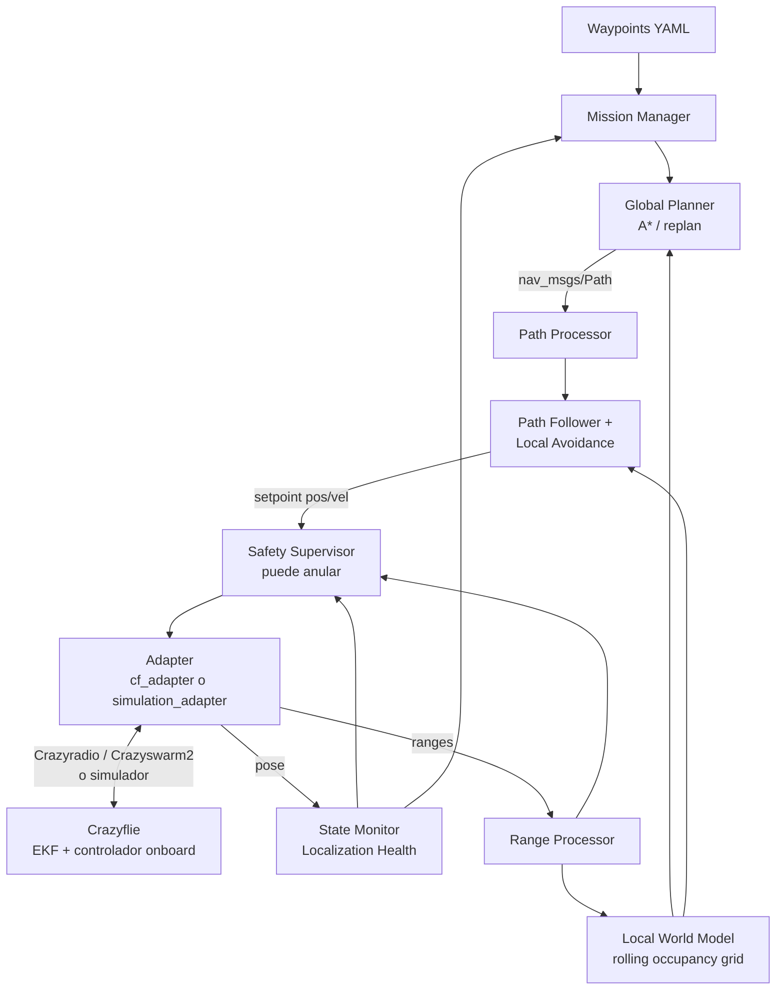

# Roadmap pre-hackathon 0–100%

Roadmap del equipo para el reto **Autonomous Navigation** de la Mobile Robotics Hackathon 2026, para Crazyflie 2.1 Brushless con Lighthouse, Flow Deck y Multi-ranger. Fuente: `Mobile_Robotics_Hackathon_2026_PreHackathon_Roadmap_v2.pdf` (4 oct 2026), adaptado al estado y al calendario del [README](../README.md).

> **Documento vivo.** Cuando terminen un TP, marquen su casilla, cambien su estado en la tabla de resumen y enlacen el PR o commit. Si algo cambia tras hablar con los mentores, actualicen aquí la decisión y el motivo.

## Cómo leer este documento

**Estado:** ✅ hecho · 🟡 parcial / en curso · ⬜ pendiente · ⏭️ pospuesto a propósito

**Prioridad** (el evento es el 10–11 oct; no da tiempo a hacer los 42 TPs):

| Prioridad | Significado |
|---|---|
| **P0** | Imprescindible antes del evento. Corresponde al MVP del README. |
| **P1** | Si sobra tiempo antes del evento, o para hacer durante el evento. |
| **P2** | Solo si todo lo anterior está estable. |

**Supuesto de hardware:** los decks Lighthouse, Flow y Multi-ranger están **anunciados** por la organización, pero no está confirmado qué lleva cada dron ni qué topics publica. Por eso la capa de abstracción (TP-09/TP-10) es P0: permite desarrollar ya sin depender de esa confirmación.

## Resumen por bloques

| Bloque | Rango | Gate (criterio de salida) | Estado |
|---|---|---|---|
| A — Foundation and reproducibility | 0–12% | Cualquier integrante clona el repo, lo abre desde WSL y compila un workspace ROS 2 limpio. | ✅ |
| B — Crazyflie stack and simulation adapter | 12–25% | Nuestro software recibe estado simulado y envía setpoints por una interfaz conectable después a Crazyswarm2. | 🟡 |
| C — State, frames and localization health | 25–39% | Hay un estado único y coherente del dron, frames validados e indicador explícito de salud. | ⬜ |
| D — Multi-ranger perception and local world model | 39–55% | Los cinco rangos producen obstáculos coherentes en un mapa local y los obstáculos viejos desaparecen. | ⬜ |
| E — Mission, planning and route generation | 55–70% | Una secuencia de waypoints genera una ruta replanificable sobre el mapa local. | ⬜ |
| F — Path following and local avoidance | 70–82% | El dron simulado sigue waypoints y sortea un obstáculo sin MPC. | ⬜ |
| G — Safety, robustness and fault injection | 82–94% | Ningún fallo simple ensayado hace que el stack siga ciegamente con comandos normales. | ⬜ |
| H — Native Ubuntu and event-ready release | 94–100% | El repo se clona en Ubuntu nativo y lanza el stack completo con configuración de evento. | ⬜ |

**Avance estimado:** ~15% (TP-01 a TP-07 hechos; bloque A completo).

## Plan priorizado 4–9 de octubre

Los TPs P0 ordenados por día. Cada día termina con una *vertical slice* ejecutable (ver [Vertical slices](#vertical-slices)).

| Día | TPs | Resultado esperado |
|---|---|---|
| 4 oct | TP-01, TP-03, TP-04 | Matriz de entorno, repo clonado dentro del filesystem de WSL, flujo de PR probado, este roadmap. |
| 5 oct | TP-06, TP-08, TP-09 | Workspace `ros2_ws`, paquete `hackathon_interfaces`, documento de comandos Crazyflie, API propia (state/ranges/command/takeoff/land/emergency). |
| 6 oct | TP-10, TP-12, TP-13, TP-14 | Simulador propio con pose y rangos sintéticos, `simulation.launch.py`, frames documentados, topic de estado único. **VS-1.** |
| 7 oct | TP-15, TP-17, TP-19, TP-20, TP-26, TP-32 | Salud de localización, banda de altura, modelo y filtrado de rangos, misión por waypoints sin obstáculos. **VS-2.** |
| 8 oct | TP-34, TP-37, TP-38, TP-39 | Evitación reactiva, Safety Supervisor, watchdogs, geofence. Pruebas T01, T02, T05, T09–T16. **VS-4 reducida** (sin mapa ni A*). |
| 9 oct | TP-42 (partes C y E) | `config/event.yaml`, runbook del evento, congelar dependencias, ensayo, video de respaldo de la simulación, preguntas para mentores, estructura del pitch. |

Si un día se retrasa, **no saltar a P1**: terminar antes la slice del día.

## Hardware y sensores

| Sensor | Qué aporta | Qué **no** es |
|---|---|---|
| Lighthouse | Pose global (posición y orientación) en el espacio calibrado. Base del frame `map`/`world`. | No es un sensor de obstáculos. |
| Flow Deck (PMW3901 + ToF inferior) | Movimiento horizontal relativo al suelo y altura relativa. Continuidad del estado entre actualizaciones globales. | No es una cámara RGB ni genera imagen del suelo. |
| Multi-ranger | Cinco distancias: `front`, `back`, `left`, `right`, `up`. | No da imagen, nube de puntos, diagonales, segmentación ni rango horizontal hacia abajo. Se modela como **cinco rayos**. |
| IMU | Aceleraciones y velocidades angulares para el estimador onboard. | No sirve para integrar posición global por sí sola. |

**Fuera del baseline:** acados/NMPC, YOLO u otras redes neuronales, cámara RGB, visual SLAM, odometría propia y modelo dinámico completo del quadrotor. El EKF onboard ya fusiona IMU, Flow, ToF y Lighthouse, y el controlador onboard se encarga de la actitud y los motores. Solo se reconsideran si el reto real lo exige.

**Pasa a ser crítico:** frames consistentes, pose estable, salud de la localización, transformar los cinco rangos al mapa, mapa local con expiración, planificación simple y determinista, setpoints compatibles con Crazyflie, evitación reactiva, un Safety Supervisor independiente del planner, y logging/replay/fault injection.

## Arquitectura



El **control de vuelo de bajo nivel permanece onboard**: el laptop no calcula PWM de motores, solo genera objetivos de navegación de alto nivel.

### Módulos y paquetes

| # | Módulo | Paquete ROS 2 | Responsabilidad |
|---|---|---|---|
| 0 | Mission Manager | `mission_manager` | Secuencia de waypoints y estado de misión (activo, completado, pausado, abortado). No decide cómo evitar obstáculos. |
| 1 | Crazyflie Interface | `cf_adapter`, `simulation_adapter` | Aísla nuestro código de la radio y la API de Crazyswarm2. El mismo stack corre con simulador ahora y con hardware después. |
| 2 | State, Frames, Localization Health | `state_monitor` | Normaliza pose y timestamps, define frames, detecta estado viejo o inválido y expone GOOD/DEGRADED/LOST. No implementa un EKF nuevo. |
| 3 | Perception / Range Processing | `range_processor` | Valida cada rango, le asocia timestamp y dirección en `base_link`, lo transforma al mapa y marca espacio libre/ocupado. |
| 4 | Local World Model | `local_world_model` | Rejilla 2D móvil (free/occupied/unknown) con inflado y expiración temporal. |
| 5 | Global Planner | `global_planner` | A* sobre la rejilla, con replan, penalización por cercanía, política para `unknown`, timeout y estado de fallo. |
| 6 | Path Processing | `path_processor` | Simplifica la ruta, hace shortcut con line of sight, genera el lookahead y limita la velocidad. |
| 7 | Path Follower + Local Avoidance | `local_navigator` | Ruta + pose + rangos → setpoint de posición o velocidad. Corrección reactiva y petición de replan. |
| 8 | Safety Supervisor | `safety_supervisor` | Anula la navegación normal por distancia mínima, TTC, pose vieja, pérdida de Lighthouse/radio/rangos, altura, planner sin ruta o setpoints vencidos. |
| 9 | Telemetry, Logging, Test Harness | `telemetry`, `hackathon_tests` | rosbag2, visualización, métricas de frecuencia y latencia, replay e inyección de fallos. |

### Tres máquinas de estados, tres capas

Son independientes y no se sustituyen entre sí:

| Capa | Estados | Dónde |
|---|---|---|
| Misión | Verificar → Despegar → Navegar ⇄ Evitar → SiguienteWaypoint → Aterrizar / Seguro | Módulo 0 (diagrama en el README) |
| Salud de localización | `GOOD`, `DEGRADED`, `LOST` | Módulo 2 |
| Seguridad | `NORMAL`, `SLOW`, `HOVER`, `LAND`, `ABORT` | Módulo 8. Tiene prioridad sobre las otras dos. |

## Estructura del repositorio

El esqueleto ya está creado: los 14 paquetes compilan con `colcon build` y `simulation.launch.py` arranca todos los nodos (todavía vacíos). La estructura del repositorio y el mapa de código están en el [README](../README.md#estructura-del-repositorio). Contratos entre paquetes: [interfaces.md](interfaces.md). Plan de simulación: [simulations.md](simulations.md).

**Cambio respecto al PDF:** `config/` no está en la raíz sino en `ros2_ws/src/hackathon_bringup/config/`, para que se instale con el paquete y los launch files la encuentren sin rutas absolutas.

Documentos que se crean con su TP: `environment_matrix.md` (TP-01), `crazyflie_command_interface.md` (TP-08), `frames.md` (TP-13), `sensor_model.md` (TP-19), `hackathon_day_runbook.md` (TP-42).

`build/`, `install/`, `log/`, los rosbags grandes y los artefactos temporales no se suben a Git.

---

## TPs detallados

Formato: `- [ ] **TP-XX — Nombre** [rango] · prioridad · estado`, con sus acciones y su DoD (*Definition of Done*).

### Bloque A — Foundation and reproducibility (0–12%)

- [x] **TP-01 — Freeze software baseline** [0–2%] · P0 · ✅
  - Baseline Ubuntu 22.04 + ROS 2 Humble (ya en uso). Documentar las versiones de Python, GCC y CMake y la distro de ROS. `main` como rama estable.
  - Hecho: [environment_matrix.md](environment_matrix.md) con baseline Ubuntu 22.04 + ROS 2 Humble + Python 3.10 (PR #1).
  - **DoD:** existe `docs/environment_matrix.md` y el equipo acepta una sola combinación.
- [x] **TP-02 — WSL2 Ubuntu 22.04** [2–4%] · P0 · ✅
  - **DoD:** Ubuntu 22.04 operativo, terminal y red funcionan.
- [x] **TP-03 — VS Code Remote WSL** [4–5%] · P0 · ✅
  - Extensiones Remote-WSL, Python, C/C++, CMake y ROS. Abrir el repo con `code .` **desde WSL**.
  - Hecho: repo clonado en `~/mobile-robotics-hackathon-crazyflie` dentro de WSL.
  - **DoD:** git, terminal, Python y build corren dentro de WSL.
- [x] **TP-04 — GitHub collaboration baseline** [5–7%] · P0 · ✅
  - Hecho: `origin`, `.gitignore` completo para ROS/Python/CMake, flujo rama → PR → merge probado (PR #1). Opcional: labels por módulo y prioridad.
  - **DoD:** flujo de PR probado; los cambios entran a `main` por PR.
- [x] **TP-05 — ROS 2 Humble development stack** [7–10%] · P0 · ✅
  - `colcon` y `rosbag2` verificados en [environment_matrix.md](environment_matrix.md).
  - **DoD:** un workspace mínimo compila y ejecuta.
- [x] **TP-06 — Workspace and common interfaces** [10–12%] · P0 · ✅
  - Crear `ros2_ws/src` y `hackathon_interfaces`. Definir convenciones de nombres de topics, frames y parámetros. Launch de smoke test.
  - Hecho: esqueleto de los 14 paquetes, mensajes propios, [interfaces.md](interfaces.md) (con guía del stack y convención de parámetros) y `simulation.launch.py`. Smoke test `scripts/smoke_test.sh`: `simulation_adapter` publica una pose fija en `/hk/adapter/odom` y `state_monitor` la reenvía a `/hk/state`.
  - **DoD:** `colcon build --symlink-install` limpio y los nodos de ejemplo se comunican.

### Bloque B — Crazyflie stack and simulation adapter (12–25%)

- [x] **TP-07 — Install Crazyswarm2** [12–15%] · P0 · ✅
  - Instalado; `hello_world` con backend `sim` y RViz funcionan (`cffirmware` y `rowan` resueltos).
  - **DoD:** los paquetes son detectables por ROS 2 y los ejemplos se ejecutan.
- [x] **TP-08 — Study Crazyflie command hierarchy** [15–17%] · P0 · ✅
  - Documentar takeoff, land, `go_to` y los setpoints de posición/velocidad (`cmd_position`, `cmd_vel_legacy`, `cmd_full_state`, etc.). Confirmar que el control de bajo nivel queda onboard. Documentar los watchdogs y qué pasa si se dejan de enviar setpoints.
  - **DoD:** `docs/crazyflie_command_interface.md` aprobado.
  - Revisión completada (7 oct): comandos, prioridades y watchdogs documentados; `scripts/verify_tp08.py` verifica callbacks y física SIL. Límites de simulación y confirmaciones pendientes de hardware explícitos en el documento.
- [x] **TP-09 — Hardware abstraction interface** [17–19%] · P0 · ✅
  - API ROS propia para `state`, `ranges`, `command`, `takeoff`, `land` y `emergency`.
  - **DoD:** ningún planner depende de nombres internos de Crazyswarm2.
  - Implementado: pose/odom/TF → API propia, scan cardinal y logging vertical opcional, POSITION/VELOCITY XY/HOVER → FullState, servicios con respuesta/timeout y bloqueo de streaming durante transiciones. 29 pruebas pasan (lógica, transporte ROS con mocks y conexión al SIL); hardware y logging real pendientes del runbook. Contrato y configuración en `docs/interfaces.md`.
- [x] **TP-10 — Simulation adapter** [19–22%] · P0 · ✅
  - Implementado: POSITION/VELOCITY XY/HOVER y yaw, límites de velocidad/aceleración, servicios de vuelo, mundo YAML y seis rangos por raycast; odometría, ground truth, TF y marcadores. Verificado: 72 pruebas pasan, incluido ciclo de vuelo mediante ROS; 3 pruebas de fallos omitidas (TP-41). Repetir con `bash scripts/verify_tp10.sh`. Integración de misión/stack: TP-12; no implica validar hardware.
  - Nodo que publica pose y rangos sintéticos (raycast contra obstáculos definidos en YAML) con la misma API que el hardware, acepta setpoints e integra un movimiento simple. No hace falta Gazebo.
  - Motivo: el backend `sim` de Crazyswarm2 no publica rangos del Multi-ranger (ver "Limitación actual" en el README).
  - **DoD:** el stack corre sin dron físico.
- [ ] **TP-11 — RViz debug scene** [22–24%] · P1 · ⬜
  - Pose, TF, rayos del Multi-ranger, waypoint y path.
  - **DoD:** la configuración de RViz está guardada en el repo.
- [x] **TP-12 — Bringup architecture** [24–25%] · P0 · ✅
  - `simulation.launch.py`, `real.launch.py` como placeholder, parámetros separados del código.
  - **DoD:** un solo comando inicia la slice de simulación.
  - Verificado: launch instalado con T01 y T03; 16 nodos, odometría → estado, rangos, servicios y TF, parámetros/overlays y cierre por Ctrl+C o salida de un nodo. Dos pruebas de configuración pasan. Repetir con `scripts/verify_tp12.py`; los nodos pendientes de los colegas arrancan como esqueletos, sin validar todavía la misión autónoma. `real.launch.py` conserva la arquitectura equivalente y requiere Crazyswarm2 externo; hardware sin probar.

### Bloque C — State, frames and localization health (25–39%)

- [ ] **TP-13 — Coordinate frames** [25–28%] · P0 · ⬜
  - Como mínimo: `map`/`world`, `odom` (si aplica), `base_link`, `front_range`, `back_range`, `left_range`, `right_range`, `up_range`, `down_tof`. Documentar signos, ejes (REP-103) y unidades.
  - **DoD:** diagrama TF y convenciones en `docs/frames.md`.
- [ ] **TP-14 — State adapter** [28–30%] · P0 · ⬜
  - Consumir la pose del simulador o del Crazyflie y publicarla en un formato normalizado con timestamp y `frame_id`.
  - **DoD:** misión y planner consumen un único topic de estado propio.
- [ ] **TP-15 — Localization health monitor** [30–33%] · P0 · ⬜
  - Evaluar edad de la pose, saltos imposibles, NaN/inf, velocidad aparente excesiva y disponibilidad de Lighthouse (si se expone). Estados `GOOD` / `DEGRADED` / `LOST`.
  - **DoD:** la inyección de fallos cambia el estado de salud correctamente.
- [ ] **TP-16 — Localization-driven speed policy** [33–35%] · P1 · ⬜
  - `GOOD`: velocidad nominal; `DEGRADED`: velocidad reducida; `LOST`: no seguir con la navegación normal.
  - **DoD:** la política se configura por YAML.
- [ ] **TP-17 — Altitude handling** [35–37%] · P0 · ⬜
  - `z_min`, `z_nominal`, `z_max`. Usar la altura estimada o el ToF inferior como dato de seguridad.
  - **DoD:** la simulación rechaza comandos fuera de límites.
- [ ] **TP-18 — Localization and frame test suite** [37–39%] · P1 · ⬜
  - Transformaciones conocidas, pose atrasada, salto artificial, pérdida del stream de estado, altura fuera de rango.
  - **DoD:** tests automatizados sin fallos.

### Bloque D — Multi-ranger perception and local world model (39–55%)

- [ ] **TP-19 — Multi-ranger measurement model** [39–41%] · P0 · ⬜
  - Dirección de cada sensor, rango mínimo/máximo aceptado, convención para *no return* y timestamp.
  - **DoD:** `docs/sensor_model.md` completo.
- [ ] **TP-20 — Range validation and filtering** [41–44%] · P0 · ⬜
  - Descartar NaN/inf, hacer clamp o invalidar lo que esté fuera de rango, filtro temporal ligero sin mucho retraso, parámetros configurables.
  - **DoD:** los spikes sintéticos no generan obstáculos persistentes.
- [ ] **TP-21 — Transform rays to map frame** [44–47%] · P1 · ⬜
  - Origen y endpoint de cada rayo a partir de TF/estado; markers en RViz.
  - **DoD:** al girar el dron, los rayos rotan correctamente en el mapa.
- [ ] **TP-22 — Rolling occupancy grid** [47–50%] · P1 · ⬜
  - Rejilla local alrededor del dron: ray tracing de espacio libre, celda ocupada en el endpoint, `unknown` en lo no observado.
  - **DoD:** un obstáculo sintético aparece donde corresponde.
- [ ] **TP-23 — Obstacle inflation** [50–52%] · P1 · ⬜
  - Radio efectivo del dron + margen configurable.
  - **DoD:** el planner no roza el obstáculo.
- [ ] **TP-24 — Dynamic-scene map decay** [52–54%] · P1 · ⬜
  - Timestamp por celda; las celdas ocupadas caducan tras un periodo configurable.
  - **DoD:** un obstáculo que desaparece se elimina del mapa.
- [ ] **TP-25 — Local world model tests** [54–55%] · P1 · ⬜
  - Pared frontal, pasillo, obstáculo que aparece, obstáculo que se mueve, pérdida de rangos.
  - **DoD:** el mapa es estable y visualmente coherente.

### Bloque E — Mission, planning and route generation (55–70%)

- [ ] **TP-26 — Mission Manager baseline** [55–58%] · P0 · ⬜
  - Waypoints desde YAML, objetivo actual, radio de llegada, timeout, pausar/abortar. Implementa la máquina de estados de misión del README.
  - **DoD:** el simulador recorre una lista de waypoints sin obstáculos.
- [ ] **TP-27 — A\* planner baseline** [58–62%] · P1 · ⬜
  - A* sobre la rejilla; start = pose actual, goal = waypoint proyectado; 4 u 8 vecinos.
  - **DoD:** encuentra ruta cuando existe y reporta fallo cuando no.
- [ ] **TP-28 — Planning cost and unknown policy** [62–64%] · P1 · ⬜
  - Coste extra cerca de obstáculos; decidir si `unknown` está bloqueado, penalizado o es transitable; parámetros en YAML.
  - **DoD:** comportamiento documentado y repetible.
- [ ] **TP-29 — Replanning triggers** [64–66%] · P1 · ⬜
  - Replanificar si el path queda ocupado, cambia el objetivo, el dron se desvía, salta el timer periódico o el local navigator reporta bloqueo.
  - **DoD:** un obstáculo nuevo provoca una ruta nueva.
- [ ] **TP-30 — Path simplification and lookahead** [66–68%] · P1 · ⬜
  - Quitar puntos colineales, shortcut con line of sight segura, lookahead adaptativo.
  - **DoD:** los setpoints no siguen un zig-zag celda por celda.
- [ ] **TP-31 — Planner test matrix** [68–70%] · P2 · ⬜
  - Espacio libre, pared, forma de U, pasillo estrecho, goal bloqueado temporalmente, obstáculo a mitad de ruta.
  - **DoD:** resultados guardados y reproducibles.

### Bloque F — Path following, local avoidance and command generation (70–82%)

- [ ] **TP-32 — Position-setpoint follower** [70–73%] · P0 · ⬜
  - Seguir el lookahead (o el waypoint directo, mientras no haya A*), limitar el paso del setpoint, mantener `z_nominal` y una política simple de yaw.
  - **DoD:** seguimiento estable sin obstáculos.
- [ ] **TP-33 — Velocity limits and smoothing** [73–75%] · P1 · ⬜
  - Velocidad máxima, límite al cambio de comando, frenar cerca del goal.
  - **DoD:** sin saltos grandes de referencia.
- [ ] **TP-34 — Reactive horizontal avoidance** [75–78%] · P0 · ⬜
  - `warning_distance` y `critical_distance`; corrección lateral u opuesta al sensor que detecta; no avanzar hacia un obstáculo cercano; pedir replan.
  - **DoD:** un obstáculo frontal inesperado no acaba en colisión simulada.
- [ ] **TP-35 — Ceiling and altitude avoidance** [78–80%] · P1 · ⬜
  - `up_range` para no subir hacia obstáculos; ToF de suelo para no bajar fuera del envelope.
  - **DoD:** los comandos verticales respetan el envelope.
- [ ] **TP-36 — Dynamic obstacle response** [80–82%] · P1 · ⬜
  - `d_dot` por sensor, TTC aproximado, slow/hover si el TTC es pequeño.
  - **DoD:** un obstáculo que se acerca provoca slowdown/hover y replan.

### Bloque G — Safety, robustness, observability and fault injection (82–94%)

- [ ] **TP-37 — Safety Supervisor state machine** [82–85%] · P0 · ⬜
  - `NORMAL`, `SLOW`, `HOVER`, `LAND`, `ABORT`, con transiciones y prioridades.
  - **DoD:** transiciones documentadas y testeadas.
- [ ] **TP-38 — Communication and stale-data watchdog** [85–87%] · P0 · ⬜
  - Detectar pose, rangos y command loop vencidos; definir una acción segura para cada caso.
  - **DoD:** cortar cada stream provoca la acción prevista.
- [ ] **TP-39 — Geofence and operational envelope** [87–89%] · P0 · ⬜
  - Límites XYZ configurables; no enviar setpoints fuera del espacio permitido.
  - **DoD:** test automático de violaciones de límites.
- [ ] **TP-40 — rosbag, telemetry, metrics** [89–92%] · P1 · ⬜
  - Grabar pose, rangos, rejilla, goal, path, comando, estado de seguridad y latencia/frecuencia. Métricas: ver [Métricas](#métricas).
  - **DoD:** una ejecución completa se puede reproducir y diagnosticar offline.
- [ ] **TP-41 — Fault injection campaign** [92–94%] · P1 · ⬜
  - Range spike, range dropout, pose retrasada, pose congelada, localización `LOST`, obstáculo insertado de repente, sin ruta temporalmente, pausa en la publicación de comandos.
  - **DoD:** matriz pass/fail completa (ver [Test matrix](#test-matrix-mínima)).

### Bloque H — Native Ubuntu migration and event-ready release (94–100%)

- [ ] **TP-42 — Native Ubuntu, release and runbook** [94–100%] · ⬜
  - [ ] **A — Ubuntu nativo** (P1): instalar 22.04 + Humble en al menos un equipo, clonar limpio, ejecutar el script de dependencias, compilar desde cero.
  - [ ] **B — Crazyradio** (P1): reglas udev/permisos USB; verificar que se ve el Crazyradio. WSL queda como entorno secundario. **Plan B:** preguntar a los mentores si se usará un NUC o Jetson de la organización.
  - [ ] **C — Configuración de evento** (P0): `config/event.yaml` con placeholders para radio URI / robot id, frame global, límites XYZ, altura nominal, umbrales de rango, velocidades, tamaño/resolución del mapa y tolerancia de waypoint.
  - [ ] **D — Bringup con un comando** (P1): `ros2 launch hackathon_bringup event.launch.py`.
  - [ ] **E — Runbook del evento** (P0): `docs/hackathon_day_runbook.md` (ver [Runbook](#runbook-del-día-del-evento)).

---

## Vertical slices

Mantener siempre una slice ejecutable en lugar de construir los módulos por separado y unirlos al final.

| Slice | Cadena | Objetivo | Estado |
|---|---|---|---|
| VS-1 | simulated pose → mission → setpoint directo → dron simulado | Validar el plumbing de ROS. | ⬜ |
| VS-2 | state → localization health → mission → setpoint | No navegar con estado inválido. | ⬜ |
| VS-3 | ranges → map → A* → follower → setpoint | Planificar alrededor de un obstáculo fijo. | ⬜ |
| VS-4 | ranges → map decay → replan → evitación reactiva → safety | Sobrevivir a cambios en la escena. | ⬜ |
| VS-5 | `simulation_adapter` → `cf_adapter` / Crazyswarm2 | Cambiar la fuente de datos sin tocar planning ni safety. | ⬜ |

## Decisiones de diseño

- **Sin MPC en el baseline.** Ruta global → lookahead / local navigator → setpoint de posición o velocidad → controlador onboard. Un NMPC externo añade modelo, tuning, solver, integración y riesgo, con poca ganancia para navegar por waypoints con sensores de rango.
- **Sin IA/visión.** No hace falta clasificar objetos, no hay cámara confirmada y el Multi-ranger ya da proximidad geométrica. Si aparece una cámara en el evento, se añade como una fuente más que publica obstáculos, sin cambiar planner, follower ni safety.
- **Navegación 2D/2.5D.** XY → A* + Multi-ranger; Z → altitud nominal + ToF de suelo + rango superior como seguridad. Un planner 3D solo si el circuito lo exige, manteniendo las mismas interfaces.

## Parámetros configurables

No hardcodear valores del evento. Todo va en YAML (`config/*.yaml`):

```yaml
control_rate: ...            # Hz
planner_rate: ...
map_resolution: ...          # m/celda
map_width: ...
map_height: ...
obstacle_inflation_radius: ...
obstacle_decay_time: ...     # s
range_min: ...
range_max: ...
warning_distance: ...
critical_distance: ...
ttc_threshold: ...
nominal_speed: ...
degraded_speed: ...
max_speed: ...
z_min: ...
z_nominal: ...
z_max: ...
waypoint_tolerance: ...
state_timeout: ...
range_timeout: ...
replan_period: ...
```

Los valores finales se definen con los mentores y el espacio real. Adaptarse al circuito debe ser cuestión de tuning, no de reescribir código.

## Test matrix mínima

Ejecutar en simulación antes del evento. Marcar ✅/❌ y enlazar el log o rosbag.

| ID | Escenario | Resultado esperado | Prioridad | Resultado |
|---|---|---|---|---|
| T01 | Un waypoint, sin obstáculos | Llega al objetivo | P0 | ⬜ |
| T02 | Varios waypoints | Avanza en orden | P0 | ⬜ |
| T03 | Obstáculo frontal estático | Replanifica y rodea | P1 | ⬜ |
| T04 | Pasillo | Mantiene margen seguro | P1 | ⬜ |
| T05 | Obstáculo aparece durante la ruta | Slow / evita / replan | P0 | ⬜ |
| T06 | Obstáculo desaparece | El decay elimina el bloqueo | P1 | ⬜ |
| T07 | Obstáculo se acerca | El TTC provoca slow/hover | P1 | ⬜ |
| T08 | Range spike | El filtro evita una decisión extrema persistente | P0 | ⬜ |
| T09 | Range dropout | Se degrada de forma segura | P0 | ⬜ |
| T10 | Pose retrasada | Safety deja de navegar normalmente | P0 | ⬜ |
| T11 | Pose congelada | Detecta estado inválido | P0 | ⬜ |
| T12 | Localización LOST | Hover/land según la política | P0 | ⬜ |
| T13 | Goal sin ruta | No avanza a ciegas | P1 | ⬜ |
| T14 | Límite de geofence | Setpoint bloqueado o recortado | P0 | ⬜ |
| T15 | Altura fuera del envelope | Comando seguro | P0 | ⬜ |
| T16 | Stream de comandos detenido | Watchdog / failsafe | P0 | ⬜ |
| T17 | Reinicio de un nodo | Se recupera o aborta de forma controlada | P1 | ⬜ |
| T18 | Replay de rosbag | Diagnóstico reproducible | P1 | ⬜ |

## Métricas

Las del README más las del TP-40:

- waypoints completados / intentados y tiempo por waypoint y total;
- colisiones o intervenciones manuales;
- distancia mínima a un obstáculo;
- número de replans;
- eventos de estado vencido (stale state);
- intervenciones del Safety Supervisor;
- ensayos repetidos con éxito;
- latencia y frecuencia de los nodos.

## Runbook del día del evento

Orden al recibir el hardware real. No volar código nuevo antes de ejecutar un ejemplo oficial.

1. Comunicación USB/radio.
2. Confirmar el firmware y la configuración entregados.
3. Verificar la pose de Lighthouse.
4. Verificar la altura del Flow Deck.
5. Verificar los cinco sensores del Multi-ranger.
6. Verificar frames y signos.
7. Despegue y hover seguros.
8. Un waypoint sin obstáculos.
9. Varios waypoints sin obstáculos.
10. Obstáculo estático.
11. Replanning.
12. Obstáculo dinámico.
13. Ajuste final de umbrales y velocidad.
14. Congelar la configuración.

## Stretch goals (no cuentan para el 100%)

D* Lite · costmap probabilístico · mejor estimación de la velocidad de obstáculos · mapa 2.5D/3D con voxels · Control Barrier Function como filtro de seguridad · MPC/acados local · cámara RGB / percepción semántica · YOLO / segmentación · coordinación multi-dron · controlador embebido propio. Ninguno debe bloquear la preparación base.

## Definición de 100%

El equipo está al 100% cuando puede demostrar, **sin hardware del evento**:

```text
Waypoints → Mission Manager → A* Planner ← Rolling Occupancy Grid ← Multi-ranger simulado + pose
          → Path Processor → Path Follower + Reactive Avoidance
          → Safety Supervisor ← Localization Health
          → Crazyflie Adapter Interface → Simulador
```

…y pasar de `Simulador → Crazyflie real / Crazyswarm2` solo requiere cambiar el adapter, la configuración, la calibración y el tuning.

**Checklist final:** clone limpio compila · simulación end-to-end · mission manager · pose y localization health · modelo del Multi-ranger · rolling map · A* y replan · path follower · evitación local · safety supervisor · rosbag/logging · campaña de fault injection · Ubuntu nativo preparado · runbook listo.

**Mínimo para el evento (P0):** todo lo anterior excepto rolling map, A* y replan, Ubuntu nativo y la campaña completa de fault injection. Esas piezas quedan como P1.

## Reparto del trabajo — equipo de 3

TP-01 a TP-07 ya completados. Cada persona desarrolla su frente en paralelo, respetando el contrato de `docs/interfaces.md`.

| Responsable | MVP / P0 | Después del MVP |
|---|---|---|
| **Persona 1 (tú): simulación e integración** | TP-08, 09, 10, 12 y 42-C/E | TP-11, 40, 41 y 42-A/B/D |
| **Persona 2: percepción y seguridad** | TP-13, 14, 15, 17, 19, 20, 37, 38 y 39 | TP-18, 21–25 |
| **Persona 3: misión y navegación** | TP-26, 32, 34 y ruta directa para el MVP | TP-16, 27–30, 33, 35, 36; TP-31 (P2) al final |

- **Primera integración:** persona 1 prepara simulador y launch (TP-10/12); persona 2, frames, estado y supervisor mínimo (TP-13/14/37); persona 3, misión y seguimiento (TP-26/32). Meta conjunta: T01, un waypoint pasando por seguridad; después T02, varios waypoints.
- **Enlace de navegación:** persona 3 implementa la ruta directa y conecta `/hk/path` con `/hk/path/processed` mediante un reenvío o configura el navegador para consumir la ruta directa. A* y simplificación siguen siendo P1.
- **Coordinación:** persona 1 mantiene interfaces, launch y YAML compartidos con aportes de los colegas. Persona 2 publica la salud de localización; persona 3 aplica la política de velocidad de TP-16.
- **Entregas:** ramas propias y PRs pequeños con lógica, conexión ROS y pruebas. Integrar diariamente; iniciar P1 cuando el MVP esté estable.
