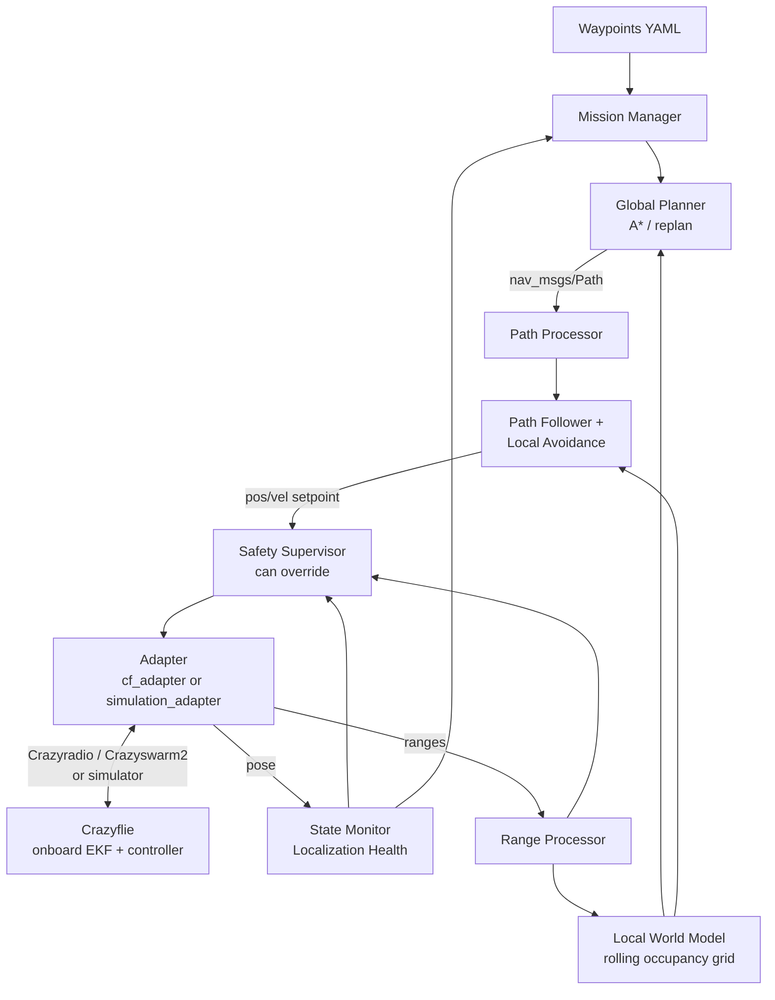

# Pre-hackathon roadmap 0–100%

Team roadmap for the **Autonomous Navigation** challenge of the Mobile Robotics Hackathon 2026, for the Crazyflie 2.1 Brushless with Lighthouse, Flow Deck and Multi-ranger. Source: `Mobile_Robotics_Hackathon_2026_PreHackathon_Roadmap_v2.pdf` (4 Oct 2026), adapted to the status and schedule of the [README](../README.md).

> **Living document.** When a TP is finished, tick its box, change its status in the summary table and link the PR or commit. If something changes after talking to the mentors, record the decision and the reason here.

## How to read this document

**Status:** ✅ done · 🟡 partial / in progress · ⬜ pending · ⏭️ deliberately postponed

**Priority** (the event was on 10–11 Oct; there was no time for all 42 TPs):

| Priority | Meaning |
|---|---|
| **P0** | Essential before the event. Corresponds to the README MVP. |
| **P1** | If time is left before the event, or to do during the event. |
| **P2** | Only if everything above is stable. |

**Hardware assumption:** the Lighthouse, Flow and Multi-ranger decks were **announced** by the organizers, but it was not confirmed which drone carries what nor which topics it publishes. That is why the abstraction layer (TP-09/TP-10) is P0: it lets us develop without depending on that confirmation.

## Summary by block

| Block | Range | Gate (exit criterion) | Status |
|---|---|---|---|
| A — Foundation and reproducibility | 0–12% | Any member clones the repo, opens it from WSL and builds a clean ROS 2 workspace. | ✅ |
| B — Crazyflie stack and simulation adapter | 12–25% | Our software receives a simulated state and sends setpoints through an interface that can later be connected to Crazyswarm2. | ✅ |
| C — State, frames and localization health | 25–39% | There is a single, consistent drone state, validated frames and an explicit health indicator. | ✅ |
| D — Multi-ranger perception and local world model | 39–55% | The five ranges produce consistent obstacles in a local map and old obstacles disappear. | ✅ |
| E — Mission, planning and route generation | 55–70% | A sequence of waypoints produces a route that can be replanned on the local map. | ✅ |
| F — Path following and local avoidance | 70–82% | The simulated drone follows waypoints and avoids an obstacle without MPC. | ✅ |
| G — Safety, robustness and fault injection | 82–94% | No rehearsed single fault makes the stack carry on blindly with normal commands. | ✅ |
| H — Native Ubuntu and event-ready release | 94–100% | The repo is cloned on native Ubuntu and launches the full stack with the event configuration. | 🟡 |

**Estimated progress:** ~90%. Blocks A–G are implemented and verified in simulation (T01–T16 matrix, C01 cooperative scenario). Native Ubuntu (TP-42 A), the single-command event launch (TP-42 D) and hardware validation of the CF1 stack remain.

## Prioritized plan 4–9 October (historical)

The P0 TPs ordered by day. Every day ends with an executable *vertical slice* (see [Vertical slices](#vertical-slices)).

| Day | TPs | Expected result |
|---|---|---|
| 4 Oct | TP-01, TP-03, TP-04 | Environment matrix, repo cloned inside the WSL filesystem, PR flow tested, this roadmap. |
| 5 Oct | TP-06, TP-08, TP-09 | `ros2_ws` workspace, `hackathon_interfaces` package, Crazyflie command document, own API (state/ranges/command/takeoff/land/emergency). |
| 6 Oct | TP-10, TP-12, TP-13, TP-14 | Own simulator with synthetic pose and ranges, `simulation.launch.py`, documented frames, single state topic. **VS-1.** |
| 7 Oct | TP-15, TP-17, TP-19, TP-20, TP-26, TP-32 | Localization health, height band, range model and filtering, waypoint mission without obstacles. **VS-2.** |
| 8 Oct | TP-34, TP-37, TP-38, TP-39 | Reactive avoidance, Safety Supervisor, watchdogs, geofence. Tests T01, T02, T05, T09–T16. **Reduced VS-4** (without map or A*). |
| 9 Oct | TP-42 (parts C and E) | `config/event.yaml`, event runbook, frozen dependencies, rehearsal, backup video of the simulation, questions for the mentors, pitch structure. |

If a day slips, **do not jump to P1**: finish that day's slice first.

## Hardware and sensors

| Sensor | What it provides | What it is **not** |
|---|---|---|
| Lighthouse | Global pose (position and orientation) in the calibrated space. Basis of the `map`/`world` frame. | Not an obstacle sensor. |
| Flow Deck (PMW3901 + bottom ToF) | Horizontal motion relative to the floor and relative height. State continuity between global updates. | Not an RGB camera and does not produce an image of the floor. |
| Multi-ranger | Five distances: `front`, `back`, `left`, `right`, `up`. | No image, point cloud, diagonals, segmentation or downward horizontal range. Modelled as **five rays**. |
| IMU | Accelerations and angular rates for the onboard estimator. | Cannot integrate a global position on its own. |

**Out of the baseline:** acados/NMPC, YOLO or other neural networks, RGB camera, visual SLAM, own odometry and a full quadrotor dynamic model. The onboard EKF already fuses IMU, Flow, ToF and Lighthouse, and the onboard controller handles attitude and motors. They are only reconsidered if the real challenge requires them.

**Becomes critical:** consistent frames, stable pose, localization health, transforming the five ranges into the map, a local map with expiry, simple and deterministic planning, Crazyflie-compatible setpoints, reactive avoidance, a Safety Supervisor independent of the planner, and logging/replay/fault injection.

## Architecture



**Low-level flight control stays onboard**: the laptop does not compute motor PWM, it only generates high-level navigation targets.

### Modules and packages

| # | Module | ROS 2 package | Responsibility |
|---|---|---|---|
| 0 | Mission Manager | `mission_manager` | Waypoint sequence and mission state (active, completed, paused, aborted). Does not decide how to avoid obstacles. |
| 1 | Crazyflie Interface | `cf_adapter`, `simulation_adapter` | Isolates our code from the radio and the Crazyswarm2 API. The same stack runs with the simulator and with hardware. |
| 2 | State, Frames, Localization Health | `state_monitor` | Normalizes pose and timestamps, defines frames, detects stale or invalid state and exposes GOOD/DEGRADED/LOST. Does not implement a new EKF. |
| 3 | Perception / Range Processing | `range_processor` | Validates each range, attaches a timestamp and direction in `base_link`, transforms it into the map and marks free/occupied space. |
| 4 | Local World Model | `local_world_model` | Rolling 2D grid (free/occupied/unknown) with inflation and time-based expiry. |
| 5 | Global Planner | `global_planner` | A* over the grid, with replanning, proximity penalty, `unknown` policy, timeout and failure state. |
| 6 | Path Processing | `path_processor` | Simplifies the route, shortcuts with line of sight, produces the lookahead and limits the speed. |
| 7 | Path Follower + Local Avoidance | `local_navigator` | Route + pose + ranges → position or velocity setpoint. Reactive correction and replan request. |
| 8 | Safety Supervisor | `safety_supervisor` | Overrides normal navigation on minimum distance, TTC, stale pose, loss of Lighthouse/radio/ranges, height, planner without a route or expired setpoints. |
| 9 | Telemetry, Logging, Test Harness | `telemetry`, `hackathon_tests` | rosbag2, visualization, run metrics, replay and fault injection. |

### Three state machines, three layers

They are independent and do not replace each other:

| Layer | States | Where |
|---|---|---|
| Mission | Check → Take off → Navigate ⇄ Avoid → NextWaypoint → Land / Safe | Module 0 (diagram in the README) |
| Localization health | `GOOD`, `DEGRADED`, `LOST` | Module 2 |
| Safety | `NORMAL`, `SLOW`, `HOVER`, `LAND`, `ABORT` | Module 8. It has priority over the other two. |

## Repository structure

The 14 packages build with `colcon build`, and `simulation.launch.py` / `simulation_cf.launch.py` start the full stack. The repository structure and the code map are in the [README](../README.md#repository-structure). Contracts between packages: [interfaces.md](interfaces.md). Simulation plan: [simulations.md](simulations.md).

**Change with respect to the PDF:** `config/` is not at the root but in `ros2_ws/src/hackathon_bringup/config/`, so it is installed with the package and the launch files find it without absolute paths.

Documents created with their TP: `environment_matrix.md` (TP-01), `crazyflie_command_interface.md` (TP-08), `frames.md` (TP-13), `sensor_model.md` (TP-19), `hackathon_day_runbook.md` (TP-42).

`build/`, `install/`, `log/`, large rosbags and temporary artefacts are not committed to Git.

---

## Detailed TPs

Format: `- [ ] **TP-XX — Name** [range] · priority · status`, with its actions and its DoD (*Definition of Done*).

### Block A — Foundation and reproducibility (0–12%)

- [x] **TP-01 — Freeze software baseline** [0–2%] · P0 · ✅
  - Ubuntu 22.04 + ROS 2 Humble baseline. Document the Python, GCC and CMake versions and the ROS distro. `main` as the stable branch.
  - Done: [environment_matrix.md](environment_matrix.md) with the Ubuntu 22.04 + ROS 2 Humble + Python 3.10 baseline (PR #1).
  - **DoD:** `docs/environment_matrix.md` exists and the team accepts a single combination.
- [x] **TP-02 — WSL2 Ubuntu 22.04** [2–4%] · P0 · ✅
  - **DoD:** Ubuntu 22.04 operational, terminal and network work.
- [x] **TP-03 — VS Code Remote WSL** [4–5%] · P0 · ✅
  - Remote-WSL, Python, C/C++, CMake and ROS extensions. Open the repo with `code .` **from WSL**.
  - Done: repo cloned in `~/mobile-robotics-hackathon-crazyflie` inside WSL.
  - **DoD:** git, terminal, Python and build run inside WSL.
- [x] **TP-04 — GitHub collaboration baseline** [5–7%] · P0 · ✅
  - Done: `origin`, complete `.gitignore` for ROS/Python/CMake, branch → PR → merge flow tested (PR #1).
  - **DoD:** PR flow tested; changes enter `main` through a PR.
- [x] **TP-05 — ROS 2 Humble development stack** [7–10%] · P0 · ✅
  - `colcon` and `rosbag2` checked in [environment_matrix.md](environment_matrix.md).
  - **DoD:** a minimal workspace builds and runs.
- [x] **TP-06 — Workspace and common interfaces** [10–12%] · P0 · ✅
  - Done: the 14 packages, own messages, [interfaces.md](interfaces.md) (with a stack guide and parameter convention) and `simulation.launch.py`. Smoke test `scripts/smoke_test.sh`.
  - **DoD:** clean `colcon build --symlink-install` and the nodes communicate.

### Block B — Crazyflie stack and simulation adapter (12–25%)

- [x] **TP-07 — Install Crazyswarm2** [12–15%] · P0 · ✅
  - Installed; `hello_world` with the `sim` backend and RViz work (`cffirmware` and `rowan` solved).
  - **DoD:** the packages are discoverable by ROS 2 and the examples run.
- [x] **TP-08 — Study Crazyflie command hierarchy** [15–17%] · P0 · ✅
  - Takeoff, land, `go_to` and position/velocity setpoints documented, low-level control onboard, watchdogs and what happens when setpoints stop.
  - **DoD:** `docs/crazyflie_command_interface.md` approved. `scripts/verify_tp08.py` checks callbacks and SIL physics.
- [x] **TP-09 — Hardware abstraction interface** [17–19%] · P0 · ✅
  - Own ROS API for `state`, `ranges`, `command`, `takeoff`, `land` and `emergency` (`cf_adapter`): pose/odom/TF → own API, cardinal scan and optional vertical logging, POSITION/VELOCITY XY/HOVER → FullState, services with response/timeout. Optional `flow_only` mode for the drone without Lighthouse.
  - **DoD:** no planner depends on internal Crazyswarm2 names.
- [x] **TP-10 — Simulation adapter** [19–22%] · P0 · ✅
  - `simulation_adapter`: kinematic model, YAML world, six raycast ranges, odometry, ground truth, TF, markers and fault injection. `sim_crazyflie` emulates the Crazyswarm2 server API for the `cf_adapter` path. Repeat with `bash scripts/verify_tp10.sh`.
  - **DoD:** the stack runs without a physical drone.
- [x] **TP-11 — RViz debug scene** [22–24%] · P1 · ✅
  - `rviz/hackathon.rviz` (`simulation.launch.py rviz:=true`): TF, local map, world obstacles, Multi-ranger rays, planner and processed path. `rviz/cf1_route.rviz` for the cooperative route.
  - **DoD:** the RViz configuration is stored in the repo.
- [x] **TP-12 — Bringup architecture** [24–25%] · P0 · ✅
  - `simulation.launch.py`, `simulation_cf.launch.py`, `real.launch.py`, parameters separated from the code. Repeat with `scripts/verify_tp12.py`.
  - **DoD:** a single command starts the simulation slice.

### Block C — State, frames and localization health (25–39%)

- [x] **TP-13 — Coordinate frames** [25–28%] · P0 · ✅
  - `map`, `base_link` and the sensor frames, signs, axes (REP-103) and units in [frames.md](frames.md).
  - **DoD:** TF diagram and conventions in `docs/frames.md`.
- [x] **TP-14 — State adapter** [28–30%] · P0 · ✅
  - `state_monitor` publishes the normalized `/hk/state` with timestamp and `frame_id`.
  - **DoD:** mission and planner consume a single own state topic.
- [x] **TP-15 — Localization health monitor** [30–33%] · P0 · ✅
  - Pose age, impossible jumps, NaN/inf and excessive apparent speed → `GOOD` / `DEGRADED` / `LOST`. Verified by T10–T12.
  - **DoD:** fault injection changes the health state correctly.
- [x] **TP-16 — Localization-driven speed policy** [33–35%] · P1 · ✅
  - `GOOD`: nominal speed; `DEGRADED`: reduced speed; `LOST`: no normal navigation.
  - **DoD:** the policy is configured in YAML.
- [x] **TP-17 — Altitude handling** [35–37%] · P0 · ✅
  - `z_min`, `z_nominal`, `z_max` in the supervisor and the navigator. Verified by T15.
  - **DoD:** the simulation rejects out-of-bounds commands.
- [ ] **TP-18 — Localization and frame test suite** [37–39%] · P1 · 🟡
  - Delayed pose, artificial jump, NaN and stream loss covered by `state_monitor/test/test_health.py` and T10–T12. Known-transform tests still missing.
  - **DoD:** automated tests without failures.

### Block D — Multi-ranger perception and local world model (39–55%)

- [x] **TP-19 — Multi-ranger measurement model** [39–41%] · P0 · ✅
  - **DoD:** `docs/sensor_model.md` complete.
- [x] **TP-20 — Range validation and filtering** [41–44%] · P0 · ✅
  - Discards NaN/inf, invalidates out-of-range values, light temporal filter, closing rate. Verified by T08 and T09.
  - **DoD:** synthetic spikes do not create persistent obstacles.
- [x] **TP-21 — Transform rays to map frame** [44–47%] · P1 · ✅
  - `range_processor/rays.py` and `/hk/ranges/markers` (hits red, no return grey).
  - **DoD:** when the drone turns, the rays rotate correctly in the map.
- [x] **TP-22 — Rolling occupancy grid** [47–50%] · P1 · ✅
  - `local_world_model/grid.py`: grid centred on the drone, Bresenham free-space ray tracing, occupied endpoint, `unknown` elsewhere.
  - **DoD:** a synthetic obstacle appears where it should.
- [x] **TP-23 — Obstacle inflation** [50–52%] · P1 · ✅
  - `obstacle_inflation_radius` (0.30 m in simulation).
  - **DoD:** the planner does not graze the obstacle (T03 clearance ≥ 0.2 m).
- [x] **TP-24 — Dynamic-scene map decay** [52–54%] · P1 · ✅
  - `obstacle_decay_time`. Verified by T06.
  - **DoD:** an obstacle that disappears is removed from the map.
- [x] **TP-25 — Local world model tests** [54–55%] · P1 · ✅
  - `test_grid.py`, `test_rays.py` plus T03–T06 and T09 end to end.
  - **DoD:** the map is stable and visually coherent.

### Block E — Mission, planning and route generation (55–70%)

- [x] **TP-26 — Mission Manager baseline** [55–58%] · P0 · ✅
  - Waypoints from YAML, current goal, arrival radius, timeout, pause/abort.
  - **DoD:** the simulator goes through a list of waypoints without obstacles (T01, T02).
- [x] **TP-27 — A\* planner baseline** [58–62%] · P1 · ✅
  - **DoD:** finds a route when there is one and reports failure when there is not (T03, T13).
- [x] **TP-28 — Planning cost and unknown policy** [62–64%] · P1 · ✅
  - Proximity cost, `unknown_policy` block/penalize/free, parameters in YAML.
  - **DoD:** documented and repeatable behaviour.
- [x] **TP-29 — Replanning triggers** [64–66%] · P1 · ✅
  - Replans when the path becomes occupied, the goal changes, the drone deviates or the periodic timer fires.
  - **DoD:** a new obstacle produces a new route (T05).
- [x] **TP-30 — Path simplification and lookahead** [66–68%] · P1 · ✅
  - **DoD:** setpoints do not follow a cell-by-cell zig-zag.
- [x] **TP-31 — Planner test matrix** [68–70%] · P2 · ✅
  - `test_planner_matrix.py` and scenarios T03, T04, T13.
  - **DoD:** stored and reproducible results.

### Block F — Path following, local avoidance and command generation (70–82%)

- [x] **TP-32 — Position-setpoint follower** [70–73%] · P0 · ✅
  - Follows the lookahead, limits the setpoint step, keeps `z_nominal`. Yaw policy: heading held by default (`face_target: false`), because turning the Multi-ranger produces false closing rates; route mode (`use_planned_path`) always holds heading.
  - **DoD:** stable tracking without obstacles.
- [x] **TP-33 — Velocity limits and smoothing** [73–75%] · P1 · ✅
  - **DoD:** no large reference jumps.
- [x] **TP-34 — Reactive horizontal avoidance** [75–78%] · P0 · ✅
  - **DoD:** an unexpected front obstacle does not end in a simulated collision (T05).
- [x] **TP-35 — Ceiling and altitude avoidance** [78–80%] · P1 · ✅
  - **DoD:** vertical commands respect the envelope (T15).
- [x] **TP-36 — Dynamic obstacle response** [80–82%] · P1 · ✅
  - Per-sensor `d_dot`, approximate TTC, slow/hover when the TTC is small.
  - **DoD:** an approaching obstacle causes slowdown/hover (T07).

### Block G — Safety, robustness, observability and fault injection (82–94%)

- [x] **TP-37 — Safety Supervisor state machine** [82–85%] · P0 · ✅
  - **DoD:** transitions documented and tested.
- [x] **TP-38 — Communication and stale-data watchdog** [85–87%] · P0 · ✅
  - **DoD:** cutting each stream triggers the intended action (T09, T12, T16).
- [x] **TP-39 — Geofence and operational envelope** [87–89%] · P0 · ✅
  - **DoD:** automated test of limit violations (T14, `test_geofence.py`).
- [ ] **TP-40 — rosbag, telemetry, metrics** [89–92%] · P1 · 🟡
  - `scripts/record_bag.sh`; `telemetry` publishes `/hk/metrics` and writes a JSON summary per run (mission state, waypoints, collisions, minimum clearance, observed safety/health/planner states, envelope). Node latency/frequency metrics are not implemented.
  - **DoD:** a full run can be reproduced and diagnosed offline.
- [x] **TP-41 — Fault injection campaign** [92–94%] · P1 · ✅
  - `scripts/run_all_scenarios.sh` runs T01–T16 with `hackathon_tests/run_scenario` and writes `/tmp/hk_runs/results.csv`.
  - **DoD:** complete pass/fail matrix (see [Minimum test matrix](#minimum-test-matrix)).

### Block H — Native Ubuntu migration and event-ready release (94–100%)

- [ ] **TP-42 — Native Ubuntu, release and runbook** [94–100%] · 🟡
  - [ ] **A — Native Ubuntu** (P1): install 22.04 + Humble on at least one machine, clean clone, run the dependency script, build from scratch.
  - [ ] **B — Crazyradio** (P1): udev rules/USB permissions. Drone 2 used the Crazyradio from WSL through usbipd ([cf2_flow_multiranger.md](cf2_flow_multiranger.md)); not yet checked for the CF1 stack.
  - [x] **C — Event configuration** (P0): `config/event.yaml` with placeholders for radio URI / robot id, global frame, XYZ limits, nominal height, range thresholds, speeds, map size/resolution and waypoint tolerance.
  - [ ] **D — Single-command bringup** (P1): `ros2 launch hackathon_bringup event.launch.py`.
  - [x] **E — Event runbook** (P0): [hackathon_day_runbook.md](hackathon_day_runbook.md). `scripts/verify_event_config.py --ready` rejects placeholders.

---

## Vertical slices

Always keep an executable slice instead of building the modules separately and joining them at the end.

| Slice | Chain | Goal | Status |
|---|---|---|---|
| VS-1 | simulated pose → mission → direct setpoint → simulated drone | Validate the ROS plumbing. | ✅ |
| VS-2 | state → localization health → mission → setpoint | Do not navigate with an invalid state. | ✅ |
| VS-3 | ranges → map → A* → follower → setpoint | Plan around a fixed obstacle. | ✅ |
| VS-4 | ranges → map decay → replan → reactive avoidance → safety | Survive scene changes. | ✅ |
| VS-5 | `simulation_adapter` → `cf_adapter` / Crazyswarm2 | Change the data source without touching planning or safety. | ✅ (emulator and Crazyswarm2 SIL) |

## Design decisions

- **No MPC in the baseline.** Global route → lookahead / local navigator → position or velocity setpoint → onboard controller. An external NMPC adds a model, tuning, a solver, integration and risk, with little gain for waypoint navigation with range sensors.
- **No AI/vision.** There is no need to classify objects, no camera was confirmed and the Multi-ranger already gives geometric proximity. If a camera appears at the event, it is added as one more source publishing obstacles, without changing planner, follower or safety.
- **2D/2.5D navigation.** XY → A* + Multi-ranger; Z → nominal altitude + bottom ToF + up range for safety. A 3D planner only if the course requires it, keeping the same interfaces.
- **Two drones, one map.** CF2 (Flow + Multi-ranger) explores and builds a 2D map; CF1 (Lighthouse + Flow) plans on that map and flies the route (README, "Final project").

## Configurable parameters

Do not hardcode event values. Everything goes into YAML (`config/*.yaml`):

```yaml
control_rate: ...            # Hz
planner_rate: ...
map_resolution: ...          # m/cell
map_width: ...
map_height: ...
obstacle_inflation_radius: ...
obstacle_decay_time: ...     # s
range_min: ...
range_max: ...
warning_distance: ...
critical_distance: ...
ttc_threshold: ...
nominal_speed: ...
degraded_speed: ...
max_speed: ...
z_min: ...
z_nominal: ...
z_max: ...
waypoint_tolerance: ...
state_timeout: ...
range_timeout: ...
replan_period: ...
```

The final values are defined with the mentors and the real space. Adapting to the course must be a matter of tuning, not of rewriting code.

## Minimum test matrix

Run in simulation (`scripts/run_all_scenarios.sh`). Result of the run on 2026-10-31 (ROS 2 Humble, WSL), `/tmp/hk_runs/results.csv`:

| ID | Scenario | Expected result | Priority | Result |
|---|---|---|---|---|
| T01 | One waypoint, no obstacles | Reaches the goal | P0 | ✅ |
| T02 | Several waypoints | Advances in order | P0 | ✅ |
| T03 | Static front obstacle | Replans and goes around it | P1 | ✅ |
| T04 | Corridor | Keeps a safe margin | P1 | ✅ |
| T05 | Obstacle appears during the route | Slow / avoid / replan | P0 | ✅ |
| T06 | Obstacle disappears | The decay removes the block | P1 | ✅ |
| T07 | Obstacle approaches | The TTC triggers slow/hover | P1 | ✅ |
| T08 | Range spike | The filter prevents a persistent extreme decision | P0 | ✅ |
| T09 | Range dropout | Degrades safely | P0 | ✅ |
| T10 | Delayed pose | Safety stops normal navigation | P0 | ✅ |
| T11 | Frozen pose | Detects an invalid state | P0 | ✅ |
| T12 | Localization LOST | Hover/land according to the policy | P0 | ✅ |
| T13 | Goal without a route | Does not advance blindly | P1 | ✅ |
| T14 | Geofence limit | Setpoint blocked or clamped | P0 | ✅ |
| T15 | Height outside the envelope | Safe command | P0 | ✅ |
| T16 | Command stream stopped | Watchdog / failsafe | P0 | ✅ |
| T17 | Node restart | Recovers or aborts in a controlled way | P1 | ⬜ manual procedure in [simulations.md](simulations.md) |
| T18 | Rosbag replay | Reproducible diagnosis | P1 | ⬜ |
| C01 | Cooperative route (CF2 map → CF1 flight) | CF1 completes the planned route | P0 | ✅ `scripts/verify_mvp_integration.py --scenario C01_cooperative_route` |

## Metrics

Those of the README plus those of TP-40:

- waypoints completed / attempted and time per waypoint and in total;
- collisions or manual interventions;
- minimum distance to an obstacle;
- number of replans;
- stale-state events;
- Safety Supervisor interventions;
- successful repeated rehearsals;
- node latency and rate.

## Event-day runbook

Order when the real hardware is received. Do not fly new code before running an official example. Details in [hackathon_day_runbook.md](hackathon_day_runbook.md).

1. USB/radio communication.
2. Confirm the delivered firmware and configuration.
3. Check the Lighthouse pose.
4. Check the Flow Deck height.
5. Check the five Multi-ranger sensors.
6. Check frames and signs.
7. Safe takeoff and hover.
8. One waypoint without obstacles.
9. Several waypoints without obstacles.
10. Static obstacle.
11. Replanning.
12. Dynamic obstacle.
13. Final tuning of thresholds and speed.
14. Freeze the configuration.

## Stretch goals (do not count towards 100%)

D* Lite · probabilistic costmap · better obstacle velocity estimation · 2.5D/3D voxel map · Control Barrier Function as a safety filter · local MPC/acados · RGB camera / semantic perception · YOLO / segmentation · multi-drone coordination · own embedded controller. None of them must block the base preparation.

## Definition of 100%

The team is at 100% when it can show, **without the event hardware**:

```text
Waypoints → Mission Manager → A* Planner ← Rolling Occupancy Grid ← simulated Multi-ranger + pose
          → Path Processor → Path Follower + Reactive Avoidance
          → Safety Supervisor ← Localization Health
          → Crazyflie Adapter Interface → Simulator
```

…and moving from `Simulator → real Crazyflie / Crazyswarm2` only requires changing the adapter, the configuration, the calibration and the tuning.

**Final checklist:** clean clone builds ✅ · end-to-end simulation ✅ · mission manager ✅ · pose and localization health ✅ · Multi-ranger model ✅ · rolling map ✅ · A* and replan ✅ · path follower ✅ · local avoidance ✅ · safety supervisor ✅ · rosbag/logging ✅ · fault injection campaign ✅ · native Ubuntu prepared ⬜ · runbook ready ✅.

**Minimum for the event (P0):** everything above except the rolling map, A* and replanning, native Ubuntu and the full fault injection campaign. Those pieces were P1.

## Work split — team of 3

| Owner | MVP / P0 | After the MVP |
|---|---|---|
| **Person 1: simulation and integration** | TP-08, 09, 10, 12 and 42-C/E | TP-11, 40, 41 and 42-A/B/D |
| **Person 2: perception and safety** | TP-13, 14, 15, 17, 19, 20, 37, 38 and 39 | TP-18, 21–25 |
| **Person 3: mission and navigation** | TP-26, 32, 34 and direct route for the MVP | TP-16, 27–30, 33, 35, 36; TP-31 (P2) at the end |

- **First integration:** person 1 prepares the simulator and launch (TP-10/12); person 2, frames, state and minimal supervisor (TP-13/14/37); person 3, mission and tracking (TP-26/32). Joint goal: T01, one waypoint through safety; then T02, several waypoints.
- **Navigation link:** person 3 implements the direct route and connects `/hk/path` with `/hk/path/processed`. A* and simplification were P1.
- **Coordination:** person 1 maintains interfaces, launch and shared YAML with contributions from the colleagues. Person 2 publishes the localization health; person 3 applies the TP-16 speed policy.
- **Deliveries:** own branches and small PRs with logic, ROS wiring and tests. Integrate daily; start P1 once the MVP is stable.
